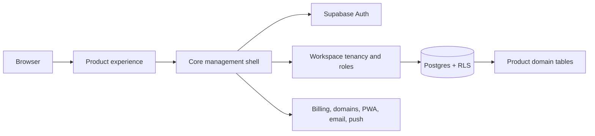

# SaaS Core

Build the product customers remember on top of the Workspace platform every
SaaS needs.

SaaS Core is a source-derived Next.js and Supabase foundation for products
that need authenticated accounts, multi-workspace tenancy, membership and
roles, server-backed entitlements, billing persistence, custom domains, PWA,
email, push, Platform administration and an agent surface. A product receives
the real application shell and owns the domain layer that begins at
`workspace_id`.

> Current coordinates: coordinated runtime/package release `2.5.0`; Core
> schema compatibility `2.0`. The `saas-core-v2.5.0` tag is the release anchor.
> This checkout's `main` branch is ahead of that tag and may contain unreleased
> changes. Treat package metadata, release constants, tags and registry checks
> as authority—not a historical paragraph in a release note.

## The shape of the platform



Core stops at the reusable Workspace boundary. Products add routes, domain
tables, catalog meaning and product UX without forking tenancy or security
infrastructure.

## What you get

| Foundation | Product-ready surface |
| --- | --- |
| Supabase Auth and session-aware routing | A complete Next.js app template |
| Workspace creation, switching, membership and roles | Auth, onboarding and management screens |
| Server-side authorization and Postgres RLS primitives | Plan, entitlement and usage surfaces |
| Durable billing and webhook persistence boundaries | PWA, domains, email and push configuration |
| Platform operator boundary and audit surfaces | Agent/WebMCP contracts and shared UI |
| Source-only migrations and conflict-aware lifecycle CLI | A dynamic consumer README, AGENTS contract and local bootstrap scripts |

The template is portable source, not a runtime dependency. The CLI materializes
it into the product repository and records a manifest of Core-managed hashes.

## Build a product

The short path uses the coordinated registry release:

```bash
pnpm add @sapienx/saas-core@^2.5.0 @sapienx/saas-core-config@^2.5.0 @sapienx/saas-core-ui@^2.5.0
pnpm add -D @sapienx/saas-core-cli@^2.5.0
pnpm exec saas-core init "My Product" ./my-product
cd my-product
pnpm install
cp .env.example .env.local
pnpm db:start
pnpm exec supabase status --workdir . -o env
pnpm db:reset
pnpm db:types
pnpm dev
```

`init` creates the product-specific `README.md`, `AGENTS.md`, `.env.example`,
`package.json`, manifest, neutral starter catalog and server-only usage
extension. It also includes runnable `lint`, `typecheck`, test, local DB,
catalog sync, verification and Core lifecycle scripts.

Product code normally lives here:

```text
my-product/
├── app/(product)/app/          # product workspace routes
├── components/product/        # product UI
├── lib/product-config.ts      # identity, home and navigation
├── product.catalog.json       # plans, limits and usage metrics
├── src/product/usage.ts       # server-only usage resolvers
├── supabase/migrations/product # product-owned migrations
└── types/supabase.ts          # generated product-aware types
```

Use [`docs/START-HERE.md`](docs/START-HERE.md) for both the Core-maintainer
and product-consumer journeys.

## Database boundary

Tenant-owned product rows must carry a `workspace_id` foreign key, an index and
explicit RLS policies. Core tables, private settings, billing persistence,
Platform tables and email outbox state are not product tables. Product
migrations belong under `supabase/migrations/product/**`.

The CLI copies and hashes Core migration source; it never runs SQL, resets a
database or overwrites a product migration. Apply source through the
consumer's controlled Supabase workflow, then regenerate and review
`types/supabase.ts`.

See [`docs/DATABASE.md`](docs/DATABASE.md) for the model, table inventory, RLS
principles and a safe first-table recipe.

## Ownership and updates

| Core owns | Product owns | Mixed |
| --- | --- | --- |
| Auth, Workspace, membership, authorization, billing, entitlements, Platform, PWA, domains, email, push, agent surface, shared UI and direct Core migrations | Product routes, domain tables, catalog, product styles, product migrations, consumer docs/env and generated Supabase types | `package.json`: product metadata/scripts remain; CLI updates only the four Core package coordinates |

Inspect before changing a consumer:

```bash
pnpm exec saas-core diff . --json
pnpm exec saas-core update . --dry-run --json
pnpm exec saas-core update .
pnpm db:reset
pnpm db:types
pnpm verify
```

Modified Core-managed files produce conflicts and are not silently replaced.
Product files are preserved. A copied migration is still unapplied source;
database readiness is verified separately by `doctor` when server credentials
are available.

Read [`docs/OWNERSHIP.md`](docs/OWNERSHIP.md) for the executable path contract
and update behavior.

## Maintainer verification

```bash
pnpm install --frozen-lockfile
pnpm lint
pnpm typecheck
pnpm test:run
pnpm core:source-parity
pnpm core:consumer-contract
```

The source contract is deliberately useful without provider credentials. With
local Supabase, add `pnpm db:start`, `pnpm db:reset`, `pnpm db:types`,
`pnpm db:test:schema` and `pnpm db:test:clean`. The full release gate also
covers package tarballs, lifecycle updates, local integration and consumer
proof; it does not publish or deploy by itself.

## Guides

- [Start here](docs/START-HERE.md)
- [Architecture](docs/ARCHITECTURE.md)
- [Ownership contract](docs/OWNERSHIP.md)
- [Database and RLS](docs/DATABASE.md)
- [Product integration](docs/PRODUCT-INTEGRATION.md)
- [Plan catalog](docs/PLAN-CATALOG.md)
- [Billing architecture](docs/BILLING-ARCHITECTURE.md)
- [Agent surface](docs/AGENT-SURFACE.md)
- [Security](docs/SECURITY.md)
- [UI system](docs/UI-SYSTEM.md)
- [Consumer upgrades](docs/UPGRADING.md)
- [Current coordinated release](docs/RELEASE-2.5.0.md)

## Principles

Core provides the hard-to-rebuild platform boundary. Products provide the
reason to use it. Keep those responsibilities visible in code, in the
database and in every update report.
