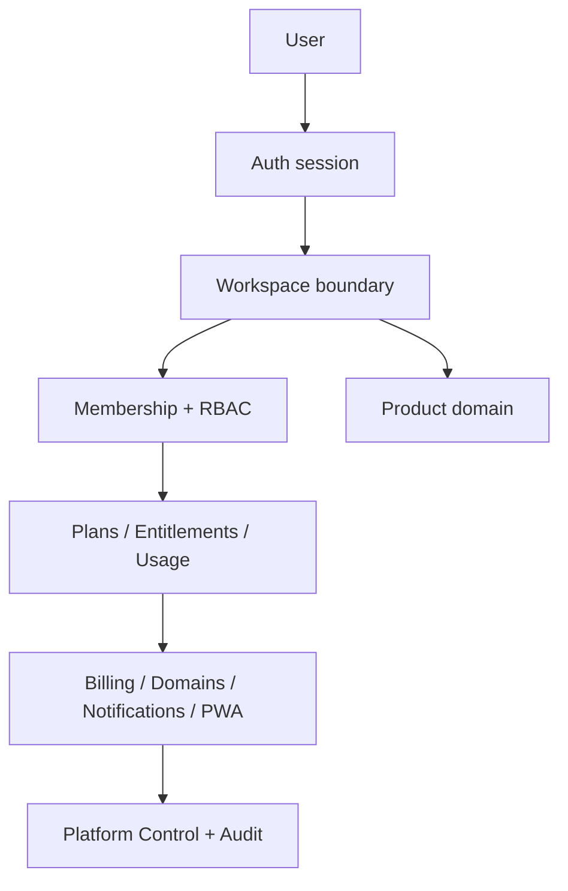

# SapienX SaaS Core

One reusable foundation for every SapienX SaaS product.

SaaS Core v1.0.0 is a provider-aware but product-neutral platform layer for
authentication, workspaces, memberships, permissions, invitations, plans,
entitlements, usage, billing state, domains, notifications, audit and Platform
Control. It owns the customer boundary up to `Workspace`; the product owns its
domain model.



Core deliberately does not know about restaurants, reservations, hotels,
properties, rooms, bookings, guests, orders or any other industry entity. A
product such as the included `Projects` example starts at:

```text
Workspace → Product-owned Projects
```

## What is included

- Strict, ESM TypeScript packages with a stable v1 error model.
- Supabase migration ownership separated from product migrations, with RLS,
  server-derived identity predicates, database-owned plans, subscription state,
  usage periods, audit events and platform roles.
- An in-memory reference store for deterministic Core Lab and unit tests.
- Paddle provider boundary; local subscription and entitlement state remains the
  runtime authorization source.
- Hashed, expiring, one-use invitations with pending seat reservation.
- Optional hostname, branding/PWA and notification provider boundaries.
- Core Lab: a responsive internal playground and scenario runner.
- CLI: `init`, `update`, `doctor`, `diff`, `info` and `test`.
- CI jobs for lint, typecheck, unit tests, build and package packing.

## Quick start

```bash
pnpm install
pnpm check
pnpm lab:dev
```

To scaffold a product project from the published package:

```bash
npx @sapienx/saas-core init projects-app
cd projects-app
pnpm install
saas-core doctor
```

The CLI never silently overwrites an existing file. It records managed file
hashes in `.saas-core.json`; product-owned files are explicitly kept outside
the managed boundary.

## CLI

| Command | Purpose |
| --- | --- |
| `saas-core init [directory]` | Safe fresh or existing-project scaffolding |
| `saas-core update` | Backup, update Core metadata and report migration handoff |
| `saas-core doctor` | Runtime, config, schema, module and integrity checks |
| `saas-core diff` | Detect drift in managed files only |
| `saas-core info` | Version, schema, modules, providers and secret-free environment summary |
| `saas-core test` | Installed-project integrity checks |

`init` supports non-interactive usage by default, so it is safe in CI. It uses
Sensible defaults: Supabase for auth/database, Paddle Sandbox for billing,
Resend for email and Web Push as an optional provider.

## Architecture and ownership

Core packages are small public entry points around the `@sapienx/saas-core`
domain implementation:

```text
packages/
  core/          domain contracts, store, CLI, errors
  auth/          server auth adapter contracts and safe redirects
  workspace/     workspace selectors and tenancy exports
  permissions/   RBAC and permission exports
  invitations/   secure invitation helpers
  entitlements/ plans and feature/limit resolution
  usage/         period meters and quota helpers
  billing/       Paddle/provider-neutral lifecycle helpers
  audit/         structured audit events
  domains/       hostname and domain lifecycle helpers
  notifications/ best-effort provider boundary
  platform/      operator roles and read-only support boundary
  pwa/           workspace manifest helper
  ui/            reusable UI contracts
  config/        typed runtime-validated configuration
  testing/       deterministic fixtures
apps/core-lab/   internal visual playground
supabase/        core-owned SQL migrations and local seed catalog
examples/        product integration example
```

`packages/core` has no framework or database client dependency. A real product
implements its server-only Supabase adapter against the same contracts. Browser
IDs are selectors, never authorization evidence. RLS is defense in depth, not a
replacement for application authorization.

## Tenancy, roles and invitations

The server resolves `auth.uid()` and then checks `workspace_members`. Default
workspace roles are `owner`, `admin`, `manager`, `member`, and `viewer`.
Platform roles are separate: `platform_owner`, `platform_admin`,
`billing_admin`, `support`, and `auditor`. Support inspection is read-only and
must not become implicit impersonation.

Invitation rows contain normalized email and a SHA-256 token hash only. Tokens
expire, cannot be replayed, reject the wrong email, and count against the plan
seat limit while pending. Acceptance is intended to be one transactional
server/database operation in a production adapter.

## Plans, entitlements, usage and billing

The `plans` table is the source of truth for feature booleans and numeric
limits. `resolveEntitlements()` applies this precedence:

```text
active manual override → scheduled plan when due → subscription plan
past_due after grace / paused / canceled → Free
```

`null` means unlimited. Usage is period-scoped and the SQL migration provides a
row-locking `private.consume_usage` function for atomic increments. Paddle is a
provider adapter only: signed, idempotent and ordered events update
`workspace_subscriptions`; product authorization reads local state.

## Database

Apply the core migration through the product's normal ordered Supabase stream:

```bash
supabase db reset
supabase migration up
```

The core migration owns tables with no product meaning: `workspaces`,
`workspace_members`, `plans`, `workspace_subscriptions`, invitations, usage,
webhook inbox, audit, platform members, domains, PWA and push subscriptions.
Product migrations should use later timestamps and add `workspace_id` to their
own entities. Do not add a universal `resources` table to Core.

## Core Lab

```bash
pnpm lab:dev
# open http://127.0.0.1:4173
```

The Lab contains overview, access, commercial, Platform Control, services and
security sections, deterministic fixture snapshots and scenario results. It is
an internal verification surface, not a customer product and it does not seed
fixtures into production.

## Configuration and providers

Use `defineSaaSCore()` from `@sapienx/saas-core-config`. Runtime validation
rejects invalid product keys and provider settings. Copy [`.env.example`](.env.example)
and keep service-role, Paddle, Resend, Vercel and VAPID secrets server-only.

Paddle, Resend, Web Push and Vercel/DNS require external credentials. Local
tests intentionally use deterministic adapters and do not pretend to have
completed provider operations.

## Documentation

- [Architecture](docs/ARCHITECTURE.md)
- [Getting started](docs/GETTING-STARTED.md)
- [CLI](docs/CLI.md)
- [Auth](docs/AUTH.md)
- [Workspaces](docs/WORKSPACES.md)
- [Permissions](docs/PERMISSIONS.md)
- [Entitlements](docs/ENTITLEMENTS.md)
- [Billing](docs/BILLING.md)
- [Database](docs/DATABASE.md)
- [RLS security](docs/RLS-SECURITY.md)
- [Platform Control](docs/PLATFORM-CONTROL.md)
- [Custom domains](docs/CUSTOM-DOMAINS.md)
- [Notifications](docs/NOTIFICATIONS.md)
- [Core Lab](docs/CORE-LAB.md)
- [Product integration](docs/PRODUCT-INTEGRATION.md)
- [Upgrading](docs/UPGRADING.md)
- [Testing](docs/TESTING.md)
- [Production](docs/PRODUCTION.md)
- [Contributing](docs/CONTRIBUTING.md)

## Development validation

```bash
pnpm lint
pnpm typecheck
pnpm test
pnpm build
pnpm pack:all
```

Live Paddle, Resend, Vercel, DNS, Web Push and cloud Supabase integration are
configuration-gated and must be verified in the target environment before
production rollout. No publish or external mutation is performed by this
repository's default checks.
