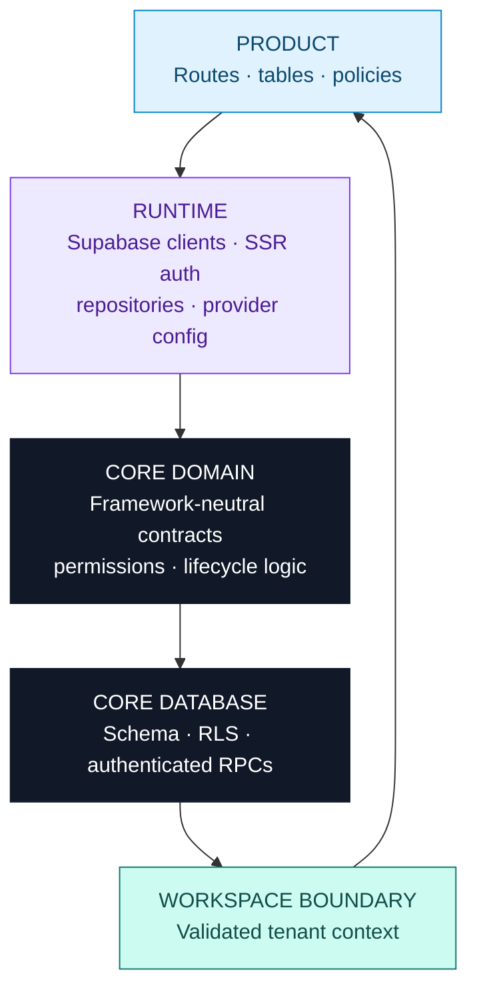

<div align="center">

  <h1>SapienX SaaS Core</h1>
  <p><strong>Reusable SaaS foundation up to the <code>Workspace</code> boundary.</strong></p>
  <p>Core owns the platform boundary. Your product owns the business domain.</p>

  <p>
    <a href="#quick-start-create-a-product">Build a product</a>
    ·
    <a href="#developing-saas-core">Develop Core</a>
    ·
    <a href="#verification-and-production-readiness">See verification</a>
  </p>

  <p>
    
    
    
    
  </p>

</div>

<table>
  <tr>
    <td width="33%" align="center">
      <strong>01 · SAAS CORE</strong><br>
      <sub>Auth · tenancy · access<br>plans · usage · billing · operations</sub>
    </td>
    <td width="8%" align="center"><strong>→</strong></td>
    <td width="26%" align="center">
      <strong>02 · WORKSPACE</strong><br>
      <sub>Customer / tenant boundary<br>validated membership context</sub>
    </td>
    <td width="8%" align="center"><strong>→</strong></td>
    <td width="33%" align="center">
      <strong>03 · PRODUCT</strong><br>
      <sub>Restaurants · bookings · orders<br>your tables · routes · policies</sub>
    </td>
  </tr>
</table>

> **The boundary in one sentence:** SaaS Core knows who the user is, which
> workspace they belong to, what that workspace is allowed to use and how the
> platform is operated. It must not know what the product’s business means.

Core deliberately does not define a universal `resources` table or rename
product entities into generic abstractions. `restaurants`, `reservations`,
`hotels`, `bookings`, `mailboxes` and `orders` belong after the boundary.

## What is inside the box?

<table>
  <tr>
    <td width="33%" valign="top">
      <h3>Identity & access</h3>
      <p>Supabase Auth, SSR/PKCE, sessions, workspaces, memberships, roles, capabilities and secure workspace selection.</p>
    </td>
    <td width="33%" valign="top">
      <h3>Commercial layer</h3>
      <p>Database-owned plans, entitlements, usage periods, atomic quotas, subscription state and Paddle evidence boundaries.</p>
    </td>
    <td width="33%" valign="top">
      <h3>Platform operations</h3>
      <p>Invitations, domains, PWA, notifications, audit, Platform Control, reconciliation and support boundaries.</p>
    </td>
  </tr>
  <tr>
    <td valign="top">
      <h3>Server safety</h3>
      <p>Core repositories, RLS, authenticated RPCs, owner protection and server-derived tenant authorization.</p>
    </td>
    <td valign="top">
      <h3>Generated app</h3>
      <p>A real Next.js App Router foundation with auth, customer workspace UI, Setup Center and operator surfaces.</p>
    </td>
    <td valign="top">
      <h3>Delivery & verification</h3>
      <p>Versioned ESM packages, CLI, ordered migrations, Core Lab, deterministic tests and Chromium acceptance coverage.</p>
    </td>
  </tr>
</table>

## Core vs Product ownership

|  | SaaS Core owns | Product owns |
| --- | --- | --- |
| **Identity** | Users, auth sessions, signup/login, recovery and safe redirects | Product profiles, preferences and business identity |
| **Tenancy** | `workspaces`, membership, lifecycle and current-workspace resolution | `restaurants`, `projects`, `properties` and other tables scoped by `workspace_id` |
| **Access** | Workspace roles, capabilities, invitations, owner protection and tenant checks | Fine-grained policies inside the product domain |
| **Commercial** | Plans, subscriptions, entitlements, usage meters, billing evidence and provider webhooks | Product feature definitions, metrics and behavior when a limit is reached |
| **Services** | Workspace domains, PWA configuration, notification boundaries and audit envelopes | Product URLs, message content, public pages and business workflows |
| **Operations** | Platform roles, support read-only access, reconciliation and operator audit | Product-specific operational tools and business data |

> Core can answer “is this user an active member of this workspace?” and “does
> this workspace have this entitlement?” It cannot answer “is this restaurant
> available for this reservation?”

## Choose your path

<table>
  <tr>
    <td width="50%" valign="top">
      <h3>→ I am building a SaaS product</h3>
      <p>Generate the foundation, add your product tables after <code>Workspace</code>, then use Core for the platform concerns.</p>
      <pre><code>npx @sapienx/saas-core init my-product
cd my-product
cp .env.example .env.local
pnpm install
supabase start
supabase db reset
pnpm dev</code></pre>
      <p><a href="#quick-start-create-a-product">Full product quick start →</a></p>
    </td>
    <td width="50%" valign="top">
      <h3>→ I am developing SaaS Core</h3>
      <p>Work in this repository, run the fast checks locally, then use the release matrix before shipping.</p>
      <pre><code>pnpm install
pnpm check
pnpm lab:dev
pnpm release:check</code></pre>
      <p><a href="#developing-saas-core">Contributor workflow →</a></p>
    </td>
  </tr>
</table>

## Quick Start: create a product

The published CLI generates a runnable Next.js App Router application and its
Core-owned Supabase migration files. The generated project is independent of
this repository.

```bash
npx @sapienx/saas-core init my-product
cd my-product
cp .env.example .env.local
pnpm install
supabase start
supabase db reset
pnpm dev
```

| Start here | Why it matters |
| --- | --- |
| `core.config.ts` | Product key, enabled modules and provider selections. |
| `src/product/README.md` | Explicit hand-off point for product tables and policies. |
| `supabase/migrations/` | Core’s ordered migration stream; add product migrations later and use `workspace_id`. |
| `/app/setup` | Setup Center with the same readiness diagnostics used by the CLI. |
| `/app` and `/platform` | Customer workspace and separate operator boundary. |

The generated project includes its own `supabase/config.toml`, an intentionally
empty `supabase/seed.sql` and bundled Core migrations. Generated products always
keep registry-compatible, versioned Core dependency specifications.
`SAAS_CORE_TARBALL_DIR` is reserved for the Core release and acceptance harness:
the harness uses its packed-artifact directory to serve a disposable local
registry, and the variable is never written to a product manifest. It is not a
product-install or dependency-override flag. Run `pnpm release:verify` from
this repository to exercise that workflow.

See [Getting started](docs/GETTING-STARTED.md) and
[Product integration](docs/PRODUCT-INTEGRATION.md).

## Generated application: what you actually get

The CLI generates a product starting point, not a product domain. The first
screen of the generated app is organized like this:

<table>
  <tr>
    <td width="33%" valign="top">
      <strong>PUBLIC / AUTH</strong><br>
      <sub><code>/</code> · <code>/signup</code> · <code>/login</code><br><code>/forgot-password</code> · <code>/reset-password</code><br><code>/auth/confirm</code> · <code>/invite/[id]</code></sub>
    </td>
    <td width="33%" valign="top">
      <strong>CUSTOMER APP</strong><br>
      <sub><code>/onboarding</code> · <code>/app</code><br><code>/app/team</code> · <code>/app/plan</code><br><code>/app/settings</code></sub>
    </td>
    <td width="33%" valign="top">
      <strong>SETUP CENTER</strong><br>
      <sub><code>/app/setup</code><br>runtime, schema and provider diagnostics<br>product boundary hand-off</sub>
    </td>
  </tr>
  <tr>
    <td width="50%" valign="top">
      <strong>PLATFORM CONTROL</strong><br>
      <sub><code>/platform</code> · workspaces · users · billing<br>overrides · domains · attention · health · audit<br>separate operator roles and permissions</sub>
    </td>
    <td width="50%" valign="top">
      <strong>PRODUCT HAND-OFF</strong><br>
      <sub><code>src/product/</code><br>your tables · routes · screens · policies<br>Core does not invent product entities</sub>
    </td>
  </tr>
</table>

### Generated route map

| Area | Representative routes |
| --- | --- |
| Public/auth | `/`, `/signup`, `/login`, `/forgot-password`, `/reset-password`, `/auth/confirm`, `/invite/[id]` |
| Customer workspace | `/onboarding`, `/app`, `/app/team`, `/app/settings`, `/app/setup` |
| Commercial | `/app/plan`, `/api/billing/checkout`, `/api/billing/portal`, `/api/billing/cancel`, `/api/billing/resume`, `/api/billing/webhook` and `/api/billing/grace` when billing is enabled |
| Platform Control | `/platform`, `/platform/workspaces`, `/platform/users`, `/platform/billing`, `/platform/overrides`, `/platform/domains`, `/platform/attention`, `/platform/health`, `/platform/audit` |

`/platform/workspaces/[id]` and `/platform/billing/[workspaceId]` provide
detail views. Platform routes require platform membership, not a customer
workspace role. Billing routes are removed when billing is disabled; domains,
PWA and Web Push are opt-in modules.

The generated app also includes `proxy.ts`, Supabase browser/server helpers,
Core repositories, `core.config.ts`, `.saas-core.json` ownership metadata and
reusable UI shell components. `init` preserves existing files; `update`
changes only unmodified managed files, creates a checkpoint and reports
product-owned conflicts.

## Developing SaaS Core

This section is for contributors working in this repository, not products
consuming the published packages.

```bash
pnpm install
pnpm check
pnpm lab:dev
```

`pnpm check` runs lint, typecheck and the default Vitest suite. Core Lab is an
internal visual playground and executable deterministic scenario runner; it is
not a customer product and should not be exposed in production.

| Command | Scope |
| --- | --- |
| `pnpm lint` | ESLint |
| `pnpm typecheck` | Repository TypeScript check |
| `pnpm test` | Default unit/domain tests; database integration is opt-in |
| `pnpm test:cli` | CLI and CI contract tests |
| `pnpm test:db` | Authenticated local-Supabase suite; requires local credentials and sets `SAAS_CORE_DB_INTEGRATION=1` |
| `pnpm test:acceptance` | Generated-app Chromium journey when the app and credentials are available |
| `pnpm build` | Builds workspace packages |
| `pnpm pack:all` | Produces package tarballs in `artifacts/` |

## High-level architecture



SaaS Core is a modular monolith delivered as versioned packages. The domain
package is framework-neutral; the runtime supplies Supabase browser, SSR and
service-role boundaries, persistence and health checks. RLS and
`SECURITY DEFINER` RPCs enforce tenant and role rules at the database boundary.
Browser-provided IDs are selectors, never authorization evidence.

The in-memory store is a reference implementation for deterministic tests, not
a production persistence layer. Core-owned tables remain product-neutral:
`workspaces`, `workspace_members`, `plans`, `workspace_subscriptions`,
`workspace_invitations`, `workspace_usage_periods`, webhook inbox, audit,
platform members, domains, PWA and push subscriptions.

## CLI overview

The `saas-core` command is shipped by `@sapienx/saas-core` and exposed by
`@sapienx/saas-core-cli`.

| Command | Purpose |
| --- | --- |
| `saas-core init [directory]` | Create a complete App Router product foundation; preserve existing files as conflicts. |
| `saas-core update [--dry-run]` | Create a recoverable checkpoint, update unmodified managed files and report conflicts. It does not apply remote migrations. |
| `saas-core doctor` | Check manifest, runtime, schema, RPC health, credentials and provider state without printing secrets. |
| `saas-core diff` | Classify managed-file, package, manifest and schema drift. |
| `saas-core info` | Print version, schema, modules, providers and a secret-free environment summary. |
| `saas-core test` | Validate the installed manifest, managed files, product boundary, generated routes, Setup Center, Platform routes and Core migration. |

`init` supports `--yes`, `--non-interactive` and `--dry-run`. Module flags are
`--with-billing`, `--without-billing`, `--with-email`, `--without-email`,
`--with-domains`, `--with-pwa`, `--with-push`, `--with-platform` and
`--without-platform`. Defaults are billing, email, Platform Control and Core
Lab enabled; domains, PWA and Web Push disabled.

`doctor` distinguishes `NOT CONFIGURED` and `CONFIGURED_UNVERIFIED` from a
live `PASS`. A provider key alone is never treated as a successful provider
operation. `update` records managed-file hashes in `.saas-core.json` and
backs up changed managed files under `.saas-core-backup/<timestamp>`.

## Verification and production readiness

<table>
  <tr>
    <th width="50%">✓ Repository / local / CI evidence</th>
    <th width="50%">△ Still requires target-environment proof</th>
  </tr>
  <tr>
    <td valign="top">
      <ul>
        <li>Lint, TypeScript, unit/domain tests, builds, packed-install checks and CLI contracts.</li>
        <li>Core Lab executes nine scenarios against fresh deterministic in-memory services.</li>
        <li>Fresh local Supabase plus authenticated RLS/RPC coverage: 23 database checks.</li>
        <li>Generated-app install, CLI diagnostics, production build and Chromium acceptance.</li>
        <li>Signup, protected routes, Setup Center, two-workspace switching, invitation wrong-account/replay protection, recovery, safe redirects and mobile overflow.</li>
      </ul>
    </td>
    <td valign="top">
      <ul>
        <li>Cloud Supabase project identity, migration history, real-user RLS, backups/restore and Auth SMTP/redirects.</li>
        <li>Paddle prices, signed webhooks, replay handling and reconciliation.</li>
        <li>Resend delivery, retry/outbox behavior and Web Push/VAPID delivery.</li>
        <li>Vercel/DNS domain lifecycle, TLS, deployment, rate limits and rollback.</li>
      </ul>
    </td>
  </tr>
</table>

```bash
pnpm release:check   # deterministic lint, typecheck, unit, build, pack and CLI gates
pnpm release:verify  # authoritative local-Supabase and generated-app matrix
```

`release:verify` resets the repository’s local Supabase database, runs the
authenticated suite, executes Core Lab, installs packed artifacts into a
temporary generated app, runs `doctor`/`diff`/`test`, builds it and drives the
Chromium journey. It is local verification; it does not publish packages or
mutate external infrastructure.

## Repository and package map

<details>
<summary><strong>Open package structure</strong></summary>

```text
apps/core-lab/              internal visual playground and scenario runner
examples/projects-product/  product-neutral integration example
packages/                   versioned Core packages
supabase/                   Core migrations, local config and catalog seed
scripts/                    release:check and release:verify
tests/                      unit, CLI, database and generated-app acceptance tests
docs/                       focused architecture, security and operations guides
```

All published `@sapienx/saas-core-*` workspace packages are currently `1.1.2`.

| Package | Role |
| --- | --- |
| `@sapienx/saas-core` | Core domain contracts, lifecycle logic, in-memory store, errors, provider diagnostics and CLI implementation. |
| `@sapienx/saas-core-runtime` | Server-safe Supabase clients, PKCE/SSR support, repositories, workspace context and health checks. |
| `@sapienx/saas-core-config` | Typed runtime-validated product configuration. |
| `@sapienx/saas-core-ui` | Brand-configurable React shell and workspace, plan, usage and status primitives. |
| `@sapienx/saas-core-auth`, `@sapienx/saas-core-workspace`, `@sapienx/saas-core-permissions`, `@sapienx/saas-core-invitations`, `@sapienx/saas-core-entitlements`, `@sapienx/saas-core-usage` | Focused public facades for identity, tenancy, authorization and commercial helpers. |
| `@sapienx/saas-core-billing`, `@sapienx/saas-core-audit`, `@sapienx/saas-core-domains`, `@sapienx/saas-core-notifications`, `@sapienx/saas-core-platform`, `@sapienx/saas-core-pwa` | Provider and operations facades around the Core contracts. |
| `@sapienx/saas-core-testing` | Deterministic fixtures and testing helpers. |
| `@sapienx/saas-core-cli` | Thin published binary package for the `saas-core` command. |

</details>

## Detailed documentation

<table>
  <tr>
    <td width="33%" valign="top">
      <strong>START & INTEGRATE</strong><br><br>
      <a href="docs/GETTING-STARTED.md">Getting started</a><br>
      <a href="docs/PRODUCT-INTEGRATION.md">Product integration</a><br>
      <a href="docs/BILLING.md">Billing</a><br>
      <a href="docs/ENTITLEMENTS.md">Entitlements</a><br>
      <a href="docs/CUSTOM-DOMAINS.md">Custom domains</a><br>
      <a href="docs/NOTIFICATIONS.md">Notifications</a>
    </td>
    <td width="33%" valign="top">
      <strong>SECURITY & PLATFORM</strong><br><br>
      <a href="docs/AUTH.md">Authentication</a><br>
      <a href="docs/WORKSPACES.md">Workspaces</a><br>
      <a href="docs/PERMISSIONS.md">Permissions</a><br>
      <a href="docs/RLS-SECURITY.md">RLS and security</a><br>
      <a href="docs/PLATFORM-CONTROL.md">Platform Control</a><br>
      <a href="docs/DATABASE.md">Database</a>
    </td>
    <td width="33%" valign="top">
      <strong>DEVELOP & RELEASE</strong><br><br>
      <a href="docs/ARCHITECTURE.md">Architecture</a><br>
      <a href="docs/CLI.md">CLI</a><br>
      <a href="docs/CORE-LAB.md">Core Lab</a><br>
      <a href="docs/TESTING.md">Testing</a><br>
      <a href="docs/PRODUCTION.md">Production</a><br>
      <a href="docs/UPGRADING.md">Upgrading</a><br>
      <a href="docs/CONTRIBUTING.md">Contributing</a>
    </td>
  </tr>
</table>

## Versioning and upgrades

| Current release | Core schema | Release note |
| --- | --- | --- |
| `1.1.2` | `1.3.1` | Generator portability and product branding hardening |

The v1.1.2 release has no database migration. The prior v1.1.1 migration is
additive and remains unchanged.

For an installed product:

```bash
saas-core doctor
saas-core diff
saas-core update --dry-run
saas-core update
```

Review the dry run, resolve product-owned conflicts, apply Core migrations
through the product’s normal ordered Supabase pipeline, then run `doctor`,
`diff`, typecheck and the relevant integration/release checks. `update` does
not silently overwrite product files and does not apply a remote database
migration automatically.

Read [Upgrading](docs/UPGRADING.md) for the v1.1.1 → v1.1.2 notes and the
[CHANGELOG](CHANGELOG.md) for release history.
