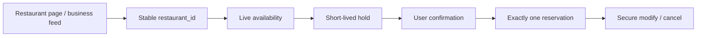
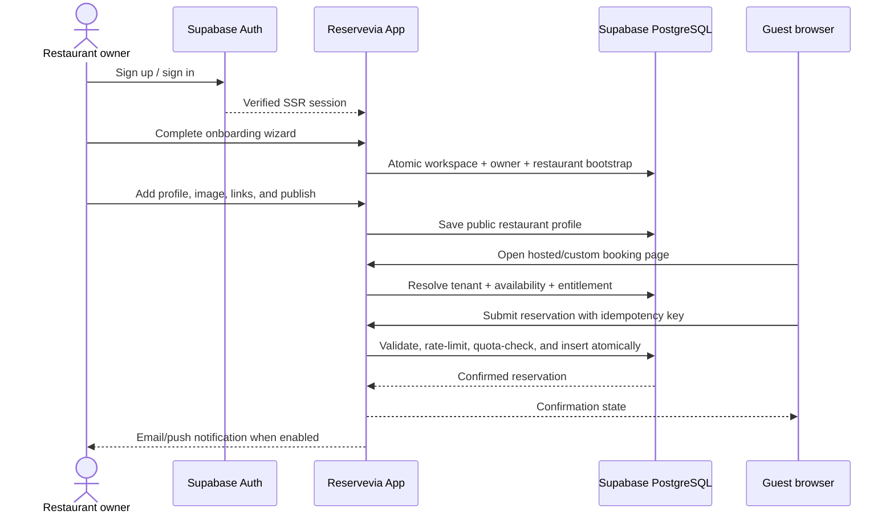
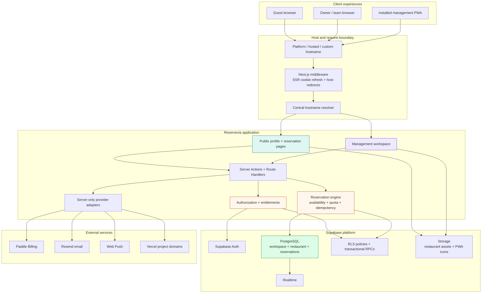
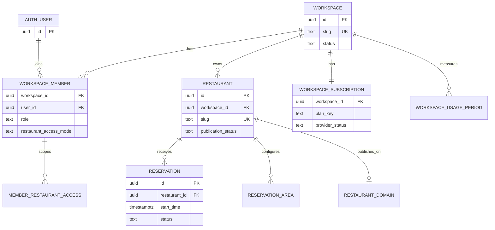
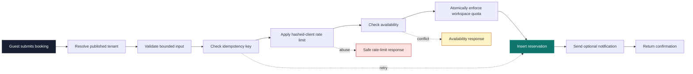
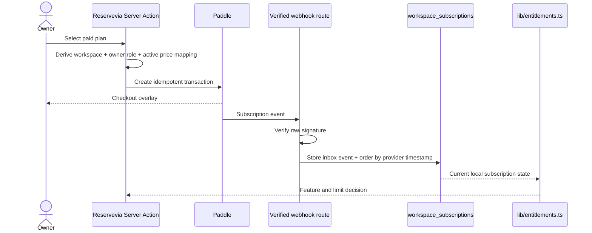

<div align="center">
  
  <h1>Reservevia</h1>
  <p><strong>Your restaurant. Online in minutes.</strong></p>
  <p>A complete reservation workspace for independent restaurants and growing hospitality groups.</p>

  <p>
    <a href="docs/ARCHITECTURE.md">Architecture</a> ·
    <a href="docs/AI-NATIVE-RESERVATIONS.md">AI architecture</a> ·
    <a href="docs/API.md">Agent API</a> ·
    <a href="docs/MCP.md">MCP</a> ·
    <a href="docs/OPENAI-RESTAURATIONS.md">OpenAI readiness</a> ·
    <a href="docs/AI-INTEGRATION-SECURITY.md">AI security</a> ·
    <a href="docs/MARKETING.md">Product story</a> ·
    <a href="docs/PRODUCTION.md">Production runbook</a>
  </p>

  <p>
    
    
    
    
    
  </p>
</div>

Reservevia turns a restaurant's online presence into a working booking channel: a public restaurant page, availability-aware reservations, a focused management workspace, team permissions, guest communication, hosted URLs, custom domains, and a branded management app as the business grows.

The repository is a production-minded **multi-tenant reservation monolith**. It preserves the existing Felix-compatible restaurant operation while providing the foundations for a standalone Reservevia SaaS product.

> **Current state:** the Phase 10A foundation is implemented and validated locally. Staging credentials, dedicated cloud projects, production DNS, Paddle Live, and final launch hardening remain intentionally separate rollout work. See [the status boundary](#where-the-project-stands).

## The product in one glance

```mermaid
flowchart LR
    A[Restaurant owner] --> B[Create account]
    B --> C[Build restaurant profile]
    C --> D[Publish booking page]
    D --> E[Guests book online]
    E --> F[Team manages reservations]
    F --> G[Email, push, reports, exports]
    G --> H[Grow into domains, PWA, and multiple restaurants]

    style A fill:#172033,color:#fff,stroke:#172033
    style D fill:#d97706,color:#fff,stroke:#d97706
    style E fill:#0f766e,color:#fff,stroke:#0f766e
    style H fill:#4338ca,color:#fff,stroke:#4338ca
```



### Why Reservevia exists

Restaurants often have to stitch together a booking link, spreadsheets, messaging tools, and a separate operations system. Reservevia gives them one clear path from **“I need a booking page”** to **“my team can run service from a shared workspace.”**

| For the guest | For the restaurant | For the growing group |
| --- | --- | --- |
| A fast, mobile-first booking experience | A public page that is ready to share | One workspace across multiple restaurants |
| Live availability and clear reservation details | Reservation operations, seating, reports, and guest history | Role-based access per restaurant |
| Confirmation and calendar-friendly communication | Email notifications and push alerts | Custom domains and a branded management PWA |

## What is implemented

- **Public booking pages** — one clean profile powers the restaurant card, hosted page, metadata, and reservation CTA.
- **Reservation operations** — availability settings, reservation areas, seating, reports, pagination, updates, and CSV export support.
- **Self-service onboarding** — email/password signup, Google PKCE flow, confirmation, password recovery, atomic first-workspace bootstrap, and a resumable mobile-first wizard.
- **Workspace-based multi-tenancy** — users belong to workspaces; workspaces own restaurants; restaurants own reservations and operational data.
- **Team collaboration** — Owner, Admin, Manager, Staff, and legacy Readonly roles with restaurant-scoped assignments and secure invitations.
- **Plans and entitlements** — Free, Starter, Pro, and Business are database-owned; limits, history windows, quotas, and features are enforced centrally.
- **Paddle Billing boundary** — Sandbox-ready checkout, verified webhooks, idempotency, event ordering protection, cancellation handling, Customer Portal sessions, and reconciliation tooling.
- **Hosted and custom domains** — `slug.reservevia.com` and verified customer-owned domains resolve through one centralized hostname boundary.
- **Branded management PWA** — installable workspace experience with conservative offline shell behavior and no reservation/customer data cached offline.
- **Restaurant-aware Web Push** — delivery is scoped to the current workspace membership and accessible restaurants.
- **Operational resilience** — tenant-scoped idempotency keys, bounded validation, short-window abuse limiting, safe errors, security headers, and health checks.
- **English and Turkish localization** — shared translation context for the product experience.
- **DataEngine acquisition boundary** — versioned, idempotent private lead ingest with first-party evidence review, Storage-backed banners, unclaimed publishing, and claim-safe provisioning. See [the DataEngine contract](docs/DATAENGINE-RESERVEVIA-CONTRACT.md).

## AI-native reservation infrastructure

Reservevia is also a provider that AI systems can recognize and use directly:



- **Human booking** — existing public pages and the existing reservation engine remain the source of truth.
- **Public restaurant data** — published pages expose server-rendered structured data without guest information.
- **Business feed** — `/api/v1/businesses` exports strict, stable, paginated public business records.
- **Agent REST API** — `/api/v1` provides discovery, live availability, optional holds, idempotent reservation mutations, and secure management.
- **Remote MCP** — `/api/mcp` exposes typed discovery, availability, reservation, and management tools over stateless Streamable HTTP.
- **OpenAI Restaurant Reservations** — `restaurant_reservation` and `ui://widget/restaurant-reservation.html` are implemented as a readiness surface; external approval is not claimed.
- **Developer docs** — the public documentation site is available at `/docs`, with Markdown, OpenAPI, and `llms.txt` representations.

Start with [the AI-native architecture](docs/AI-NATIVE-RESERVATIONS.md), [the agent guide](docs/public/agents.md), [the API contract](docs/API.md), [MCP](docs/MCP.md), [OpenAI readiness](docs/OPENAI-RESTAURATIONS.md), and [AI integration security](docs/AI-INTEGRATION-SECURITY.md).

## A customer journey designed for momentum



## Plans that grow with the restaurant

The `plans` catalog in Supabase is the commercial source of truth. The application reads the same rows for the public pricing page, runtime entitlements, usage limits, and management UI.

| Plan | Price | Restaurants | Users | Reservations | Highlights |
| --- | ---: | ---: | ---: | ---: | --- |
| **Free** | $0/mo | 1 | 1 | 100/mo | Hosted booking page, basic analytics, reservation push alerts, 30-day history |
| **Starter** | $19/mo | 1 | 3 | 500/mo | Custom domain, email notifications, push alerts, CSV export, 1-year history |
| **Pro** | $49/mo | 1 | 10 | Unlimited | Guest history, advanced reports, branded PWA, push notifications |
| **Business** | $99/mo | 3 | 20 | Unlimited | Push alerts, multi-restaurant management with one shared workspace |

Prices and limits are rendered from database catalog rows at runtime. This table mirrors the current catalog; it is not a second pricing implementation.

## Architecture: one application, explicit boundaries

Reservevia uses a server-first Next.js App Router architecture. The monolith is deliberate: public booking, management actions, billing state, tenant resolution, and authorization share one domain model while provider integrations remain isolated behind server-only boundaries.



### The tenant model



This model keeps the security and product boundaries aligned:

```text
auth.uid()
   ↓
workspace_members
   ↓
workspaces
   ↓
restaurants
   ↓
restaurant-owned records
```

Server authorization derives scope from the authenticated session. Browser-provided IDs are selectors, never proof of ownership. PostgreSQL RLS adds a second line of defense, while privileged service-role access is restricted to server-only operations that explicitly need it.

## The reservation path: safe under retries and races



The reservation is committed independently from optional email or push delivery. A provider failure does not roll back the booking, and a network retry cannot silently create a duplicate reservation.

## Billing is a provider boundary, not an authorization shortcut



Paddle owns checkout and financial lifecycle events. Reservevia owns the local subscription state and runtime entitlements. Paid access is never granted from a browser callback; it becomes effective only after a verified webhook updates the workspace subscription.

## Technical foundations

### Server-first application layer

- **Next.js 16.3.0 App Router** for server-rendered public pages, management routes, route handlers, and server actions.
- **React 19 + strict TypeScript** for the UI and typed domain contracts.
- **Tailwind CSS + Radix/shadcn-style primitives** for a responsive, accessible component system.
- **One deployable monolith** so public resolution, management access, and reservation rules share the same tenant model.

### Data, auth, and authorization

- **Supabase PostgreSQL** is the primary data store; there is no ORM.
- **Ordered SQL migrations** preserve the inherited schema and add the Reservevia workspace, plan, billing, domain, team, PWA, push, and safety layers.
- **Supabase Auth + `@supabase/ssr`** provide browser/server clients, PKCE confirmation, password recovery, and proxy cookie refresh.
- **Centralized authorization** in `lib/authorization.ts` resolves workspace, role, restaurant scope, and reservation access.
- **RLS and transactional RPCs** protect memberships, restaurant data, Storage objects, subscriptions, and quota-sensitive mutations.

### Public identity and domains

- A restaurant's profile row is the single source for its card and public booking page.
- Stable, globally unique slugs produce hosted URLs such as `felix-beach.reservevia.com`.
- Verified customer domains map to a restaurant through `restaurant_domains`.
- Hostname resolution is centralized; a tenant host cannot switch restaurants through a query parameter.
- Public rendering does not call Vercel. Vercel domain operations stay behind a server-only `@vercel/sdk` boundary.

### Notifications and installable operations

- **Resend** handles application email such as invitations and reservation notifications for every plan.
- **Web Push** subscriptions are tied to workspace, user, device, and accessible restaurant scope.
- **Management PWA** uses workspace branding and a conservative service worker that caches the shell only.
- No reservation, guest, billing, team, API, or Supabase response is persisted in the offline cache; offline reservation writes are intentionally not implemented.

### Reliability and safety controls

- Tenant-scoped public idempotency keys.
- Bounded server-side reservation input validation.
- Atomic PostgreSQL reservation quota enforcement.
- Short-window abuse limiting using a hashed client identity; raw IP is not stored as product data.
- Security headers, production-only HSTS, safe health response, and production denial of legacy setup/test routes.
- Provider failures are isolated from the core reservation commit.

## Where the project stands

| Area | Current state |
| --- | --- |
| Product foundation | Implemented: public marketing, restaurant pages, reservations, management, onboarding, teams, plans, domains, PWA, push, and localization |
| Local development | Implemented and isolated through Supabase CLI on ports `54521–54524` |
| Automated confidence | Unit, authorization, profile, billing, domain, PWA, email, and local Supabase RLS/integration coverage are in the repository |
| Billing | Paddle Sandbox-ready in code; real Sandbox products, prices, credentials, and checkout evidence are still provider-dependent |
| Cloud staging | Schema-only bootstrap and runbook are ready; dedicated Reservevia Supabase/Vercel projects are rollout work |
| Production domains | Hostname architecture is implemented; wildcard DNS, custom-domain E2E, and cutover remain pending |
| Launch hardening | Custom SMTP, CAPTCHA, production VAPID/device tests, monitoring activation, legal review, and Paddle Live remain pending |

This boundary is deliberate: the repository does not claim a production launch, live billing, DNS migration, compliance certification, or SLA that has not been completed.

## Quick start

### Requirements

- Node.js 24 LTS
- pnpm 11.21.0
- Supabase CLI (installed locally by `pnpm install`)
- Docker Desktop or another Docker-compatible runtime, running for the local Supabase stack

### Run against the isolated local environment

Run these commands from the repository root:

```bash
pnpm install --frozen-lockfile
cp .env.example .env.local

pnpm run db:start
pnpm run db:reset
pnpm run dev:local
```

Open the app at the port printed by Next.js. Local Auth emails are captured by [Mailpit](http://127.0.0.1:54524); use it to open signup confirmation and password recovery links.

Keep `pnpm run dev:local` running in its own terminal. The validation commands can run in a second terminal; `pnpm run auth:e2e` uses the local app at `http://localhost:3000` by default. If Next.js selects another port, set `RESERVEVIA_APP_URL` to the printed URL for that command.

For a regular environment-backed run:

```bash
pnpm run dev
```

Never point local commands at FelixRez production credentials or a non-local database. The guarded database, billing, domain, and reconciliation scripts refuse unsafe environments where applicable.

## Validation commands

```bash
pnpm run lint
pnpm run typecheck
pnpm run test:run
pnpm run db:test
pnpm run auth:e2e
pnpm run e2e:critical
pnpm run build:local
```

The test layers, deterministic local scenarios, browser fixtures, and CI
gates are documented in [Testing](docs/TESTING.md).

Useful operational commands:

```bash
pnpm run db:types
pnpm run db:bootstrap:generate
pnpm run dev:set-plan -- <workspace-slug> <free|starter|pro|business>
pnpm run billing:reconcile -- <workspace-slug>
pnpm run domains:reconcile -- <restaurant-slug>
```

The repository scripts use the pinned project-local Supabase CLI. For direct CLI commands, use `pnpm exec supabase ...`.

Run `npm audit` before releases. Do not run `npm audit fix --force` automatically; it may upgrade core packages outside the validated baseline.

## Repository map

```text
app/                    Next.js routes, server actions, and route handlers
components/             Product UI, public restaurant pages, marketing, and management surfaces
context/                Language and management workspace context
lib/                    Domain services, auth, authorization, entitlements, providers, and utilities
supabase/migrations/    Ordered schema evolution
supabase/bootstrap/     Schema-only fresh-cloud bootstrap artifacts
supabase/templates/     Auth email templates for confirmation and recovery
scripts/                Local DB, auth E2E, billing, domains, and bootstrap tooling
test/                   Unit, authorization, billing, RLS, and integration coverage
e2e/                    Playwright browser fixtures and critical/full user flows
docs/                   Architecture, rollout, onboarding, domains, billing, PWA, and marketing details
public/                 Brand assets, icons, service worker, and example restaurant media
```

## Documentation map

- [Architecture](docs/ARCHITECTURE.md) — runtime boundaries, database lifecycle, ownership model, entitlements, domains, PWA, and deferred phases.
- [Testing](docs/TESTING.md) — Vitest, Supabase integration, Auth/Mailpit, Playwright, deterministic scenarios, and CI gates.
- [Marketing website](docs/MARKETING.md) — public positioning, route/host boundary, pricing source of truth, SEO, and legal status.
- [Self-service onboarding](docs/ONBOARDING.md) — signup, SSR auth, atomic workspace bootstrap, resumable wizard, and publishing flow.
- [Team and multi-restaurant access](docs/TEAM-AND-MULTI-RESTAURANT.md) — roles, invitations, restaurant assignments, and Business workspaces.
- [Paddle Billing](docs/PADDLE-BILLING.md) — Sandbox setup, checkout, webhooks, lifecycle mapping, reconciliation, and Live rollout boundary.
- [Domains](docs/DOMAINS.md) — hosted URLs, custom domains, hostname safety, provider boundary, and DNS rollout.
- [PWA and Web Push](docs/PWA-AND-PUSH.md) — workspace branding, offline policy, subscriptions, and recipient authorization.
- [Production runbook](docs/PRODUCTION.md) — environment separation, cloud bootstrap, security baseline, staging evidence, and Phase 10B cutover.

## Security and data handling

Secrets belong in the environment provider, never in Git. Do not commit `.env`, `.env.local`, database credentials, service-role keys, API keys, Vercel tokens, Paddle webhook secrets, or VAPID private keys.

Reservevia is designed with defense in depth, but this repository does not claim regulatory certification, legal approval, or a production SLA. Review the [Privacy](app/privacy/page.tsx) and [Terms](app/terms/page.tsx) drafts with qualified counsel before launch.

## License and project status

This is a private product repository at the current stage of development. Licensing, contribution policy, and public launch terms have not been declared.
