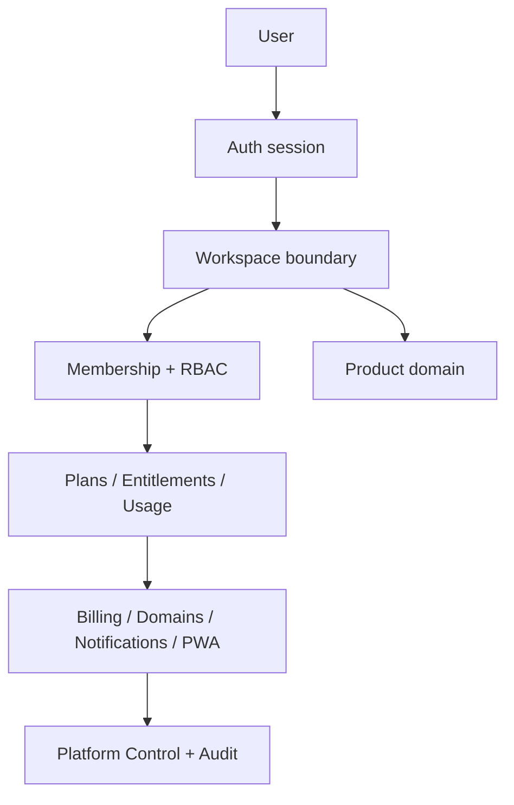

# SapienX SaaS Core

One reusable foundation for every SapienX SaaS product.

SaaS Core v1.0.0 is a provider-aware but product-neutral platform layer for
authentication, workspaces, memberships, permissions, invitations, plans,
entitlements, usage, billing state, domains, notifications, audit and Platform
Control. It owns the customer boundary up to `Workspace`; the product owns its
domain model.



Core deliberately does not know about restaurants, reservations, hotels,
properties, rooms, bookings, guests, orders or any other industry entity. A
product such as the included `Projects` example starts at:

```text
Workspace → Product-owned Projects
```

## What is included

- Strict, ESM TypeScript packages with a stable v1 error model.
- Supabase migration ownership separated from product migrations, with RLS,
  server-derived identity predicates, database-owned plans, subscription state,
  usage periods, audit events and platform roles.
- A first-class `@sapienx/saas-core-runtime` package with Supabase browser/server/service-role clients, PKCE cookie handling and Core repositories.
- Authenticated database RPCs for workspace, membership, invitation, entitlement, usage, domain, PWA and push mutations.
- An in-memory reference store for deterministic Core Lab and unit tests; the Lab reports actual executed operations and results.
- Paddle provider boundary; local subscription and entitlement state remains the
  runtime authorization source.
- Hashed, expiring, one-use invitations with pending seat reservation.
- Optional hostname, branding/PWA and notification provider boundaries.
- Core Lab: a responsive internal playground and scenario runner.
- CLI: `init`, `update`, `doctor`, `diff`, `info` and `test`.
- CI jobs for lint, typecheck, unit, build, packed-install, local-Supabase RLS, browser auth smoke and Core Lab execution.

## Quick start

```bash
pnpm install
pnpm check
pnpm lab:dev
```

To scaffold a product project from the published package:

```bash
npx @sapienx/saas-core init projects-app
cd projects-app
cp .env.example .env.local
pnpm install
supabase start
supabase db reset
pnpm dev
```

The generated project includes `supabase/config.toml` and an explicit empty
`supabase/seed.sql`, so the local database is independent of the Core
repository. The generated app exposes `/signup`, `/login`, `/forgot-password`,
`/reset-password`, `/app`, `/app/team`, `/app/plan`, `/app/settings` and
`/platform` without product-specific implementation work.

The generated project is a real Next.js App Router application. It includes
Supabase SSR/PKCE auth routes, protected middleware, onboarding, the reusable
Core UI shell, workspace/team/plan/settings/platform routes and the ordered
Core migrations. Use local packed artifacts during repository development with
`SAAS_CORE_TARBALL_DIR=/path/to/saas-core/artifacts`.

```bash
saas-core doctor
saas-core diff
saas-core test
saas-core update --dry-run
```

`doctor` distinguishes missing credentials from a passing check and never
prints secret values. `update` creates a recoverable checkpoint, updates only
unmodified managed files and reports product-owned conflicts; the v1 fixture
path upgrades the manifest, managed package versions and missing Core
migrations while preserving modified product files. Database migrations remain
in the normal Supabase migration workflow.

The CLI never silently overwrites an existing file. It records managed file
hashes in `.saas-core.json`; product-owned files are explicitly kept outside
the managed boundary.

## CLI

| Command | Purpose |
| --- | --- |
| `saas-core init [directory]` | Safe fresh or existing-project scaffolding |
| `saas-core update [--dry-run]` | Checkpoint and conflict-safe managed-file upgrade |
| `saas-core doctor` | Environment, config, schema, credentials and drift checks |
| `saas-core diff` | Classify managed/generated/package drift |
| `saas-core info` | Version, schema, modules, providers and secret-free environment summary |
| `saas-core test` | Installed-project integrity checks |

`init` supports `--yes`, `--non-interactive` and `--dry-run`, so it is usable in
CI as well as interactively. Defaults are Supabase for auth/database, Paddle
Sandbox for billing, Resend for email and optional Web Push/Vercel domains.

## Architecture and ownership

Core packages are small public entry points around the `@sapienx/saas-core`
domain implementation:

```text
packages/
  core/          domain contracts, store, CLI, errors
  auth/          server auth adapter contracts and safe redirects
  workspace/     workspace selectors and tenancy exports
  permissions/   RBAC and permission exports
  invitations/   secure invitation helpers
  entitlements/ plans and feature/limit resolution
  usage/         period meters and quota helpers
  billing/       Paddle/provider-neutral lifecycle helpers
  audit/         structured audit events
  domains/       hostname and domain lifecycle helpers
  notifications/ best-effort provider boundary
  platform/      operator roles and read-only support boundary
  pwa/           workspace manifest helper
  ui/            reusable UI contracts
  config/        typed runtime-validated configuration
  testing/       deterministic fixtures
apps/core-lab/   internal visual playground
supabase/        core-owned SQL migrations and local seed catalog
examples/        product integration example
```

`packages/core` remains framework-neutral. The runtime package owns the
server-only Supabase integration so a product supplies credentials and calls
Core repositories rather than reimplementing auth/session plumbing. Browser
IDs are selectors, never authorization evidence. RLS and SECURITY DEFINER RPCs
are defense in depth and enforce the same role/tenant rules as the application.

## Tenancy, roles and invitations

The server resolves `auth.uid()` and then checks `workspace_members`. Default
workspace roles are `owner`, `admin`, `manager`, `member`, and `viewer`.
Platform roles are separate: `platform_owner`, `platform_admin`,
`billing_admin`, `support`, and `auditor`. Support inspection is read-only and
must not become implicit impersonation.

Invitation rows contain normalized email and a SHA-256 token hash only. Tokens
expire, cannot be replayed, reject the wrong email, rotate on resend, enforce a
cooldown and count against the plan seat limit while pending. Acceptance is a
transactional database operation with seat locking and duplicate protection.
The generated Team flow sends through Resend when configured; otherwise it
shows a clearly labeled development-only local link. `/invite/[id]` preserves
the invitation through login or signup, validates the current account email,
accepts once, and selects the invited workspace.

The current workspace is stored in a secure, server-owned cookie and resolved
against active memberships on every server request. The WorkspaceSwitcher
therefore applies consistently to `/app`, team, plan, settings and product
routes; an arbitrary or suspended workspace ID is rejected server-side.

## Plans, entitlements, usage and billing

The `plans` table is the source of truth for feature booleans and numeric
limits. `resolveEntitlements()` applies this precedence:

```text
active manual override → scheduled plan when due → subscription plan
past_due after grace / paused / canceled → Free
```

`null` means unlimited. Usage is period-scoped and the SQL migration provides a
row-locking `consume_usage` RPC for atomic increments against the effective
plan. Paddle is provider evidence: raw signed events enter a durable inbox,
duplicate/old events are rejected, and product authorization reads local state.
Generated billing routes include `/api/billing/checkout`, `portal`, `cancel`,
`resume`, `webhook` and `grace`. The browser submits a Core plan key and
interval; the server resolves `PADDLE_PRICE_<PLAN>_<MONTH|YEAR>` mappings.
Doctor reports configured-but-unverified providers instead of treating a key
as a successful live integration.

## Database

Apply the core migration through the product's normal ordered Supabase stream:

```bash
supabase db reset
supabase migration up
```

Fresh local projects should use `supabase start` followed by `supabase db reset`.
The repository migration is the canonical security contract; generated apps
receive the same bundled Core migration files from the CLI package.

The core migration owns tables with no product meaning: `workspaces`,
`workspace_members`, `plans`, `workspace_subscriptions`, invitations, usage,
webhook inbox, audit, platform members, domains, PWA and push subscriptions.
Product migrations should use later timestamps and add `workspace_id` to their
own entities. Do not add a universal `resources` table to Core.

## Core Lab

```bash
pnpm lab:dev
# open http://127.0.0.1:4173
```

The Lab contains overview, access, commercial, Platform Control, services and
security sections. Its scenario endpoint executes the Core operations on a
fresh deterministic in-memory fixture and returns status, duration, expected
result, actual result, operation and error code. It is an internal verification
surface, not a customer product and it does not seed fixtures into production.
The canonical statuses are `PASS`, `BLOCKED_AS_EXPECTED`, `FAIL` and `SKIPPED`;
the in-memory mode is explicitly separate from the authenticated local-
Supabase/RLS suite.

## Configuration and providers

Use `defineSaaSCore()` from `@sapienx/saas-core-config`. Runtime validation
rejects invalid product keys and provider settings. Copy [`.env.example`](.env.example)
and keep service-role, Paddle, Resend, Vercel and VAPID secrets server-only.

Paddle, Resend, Web Push and Vercel/DNS require external credentials. Local
tests intentionally use deterministic adapters and do not pretend to have
completed provider operations.

## Documentation

- [Architecture](docs/ARCHITECTURE.md)
- [Getting started](docs/GETTING-STARTED.md)
- [CLI](docs/CLI.md)
- [Auth](docs/AUTH.md)
- [Workspaces](docs/WORKSPACES.md)
- [Permissions](docs/PERMISSIONS.md)
- [Entitlements](docs/ENTITLEMENTS.md)
- [Billing](docs/BILLING.md)
- [Database](docs/DATABASE.md)
- [RLS security](docs/RLS-SECURITY.md)
- [Platform Control](docs/PLATFORM-CONTROL.md)
- [Custom domains](docs/CUSTOM-DOMAINS.md)
- [Notifications](docs/NOTIFICATIONS.md)
- [Core Lab](docs/CORE-LAB.md)
- [Product integration](docs/PRODUCT-INTEGRATION.md)
- [Upgrading](docs/UPGRADING.md)
- [Testing](docs/TESTING.md)
- [Production](docs/PRODUCTION.md)
- [Contributing](docs/CONTRIBUTING.md)

## Development validation

```bash
pnpm lint
pnpm typecheck
pnpm test
pnpm build
pnpm pack:all
```

For the authenticated database suite, start a fresh local Supabase instance
and opt in explicitly:

```bash
supabase start
supabase db reset
SAAS_CORE_DB_INTEGRATION=1 SUPABASE_URL=http://127.0.0.1:54321 \
  SUPABASE_ANON_KEY=<local-anon-key> SUPABASE_SERVICE_ROLE_KEY=<local-service-key> \
  pnpm test -- tests/database.integration.test.ts
```

The authenticated suite contains 20 sequential database checks covering RLS,
RPC-only writes, owner safety, invitation replay and seat races, effective
entitlements, usage concurrency and platform roles. CI also runs the packed
generated-app browser journey, with protected routes, safe redirects, workspace
switching, invitation acceptance/replay protection and mobile overflow included
in that job. The browser job writes local Supabase credentials before installing,
building or starting the generated app.

Live Paddle, Resend, Vercel, DNS, Web Push and cloud Supabase integration are
configuration-gated and must be verified in the target environment before
production rollout. No publish or external mutation is performed by this
repository's default checks.
