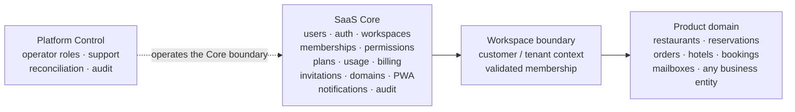
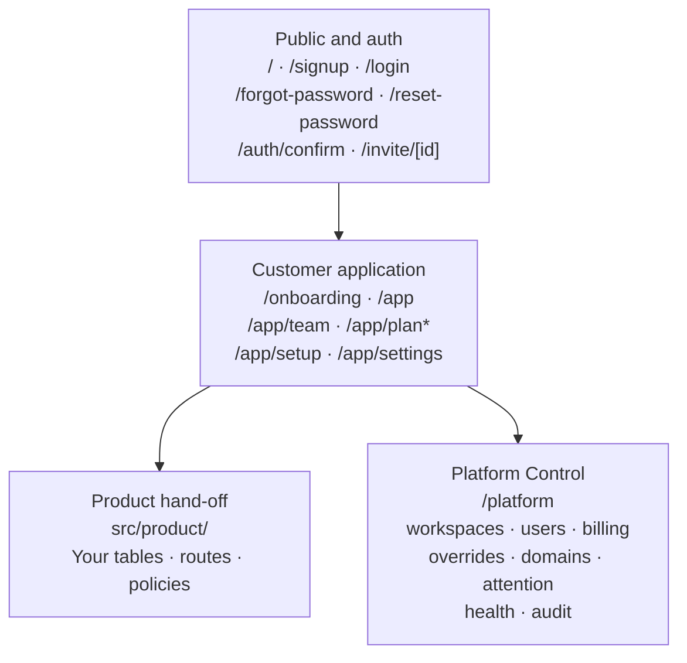

# SapienX SaaS Core

Reusable SaaS foundation up to the `Workspace` boundary.

SaaS Core gives a product the shared platform it should not have to rebuild:
authentication, users, workspaces, memberships, permissions, plans,
entitlements, usage, billing state, invitations, domains, PWA hooks,
notifications, audit and Platform Control. The product starts after that
boundary and owns its business model, routes, screens and policies.



The rule is simple: if a concept is specific to the product’s business, it
does not belong in Core. Core does not define a universal `resources` table or
rename product entities into generic abstractions.

| Current release | Core schema | Runtime baseline |
| --- | --- | --- |
| `1.1.1` | `1.3.1` | Node `>=24`, pnpm `>=10` |

## What you get

| Area | SaaS Core provides |
| --- | --- |
| Identity and tenancy | Supabase Auth with SSR/PKCE helpers, secure session handling, workspaces, membership resolution and server-owned workspace selection. |
| Authorization | Workspace roles (`owner`, `admin`, `manager`, `member`, `viewer`), named capabilities, separate Platform Control roles and least-privilege checks. |
| Commercial state | Database-owned plans, subscriptions, feature entitlements, usage periods and atomic quota operations. Paddle is an evidence/provider boundary; local Core state authorizes requests. |
| Customer operations | Hashed one-use invitations, optional custom domains, workspace PWA settings, Resend/Web Push boundaries and structured audit events. |
| Platform operations | Role-aware Workspace 360, support inspection, billing/domain reconciliation boundaries, overrides, attention, health and redacted audit views. |
| Delivery surface | Versioned ESM TypeScript packages, Supabase migrations/RLS/RPCs, a server-safe runtime, reusable UI primitives, the `saas-core` CLI, Core Lab and deterministic testing fixtures. |

## Core vs Product ownership

`Workspace` is the customer boundary. Core establishes and protects it; the
product uses it as the tenant key for everything it owns afterwards.

| Boundary | Core owns | Product owns |
| --- | --- | --- |
| Identity | Users, auth sessions, signup/login, recovery, safe redirects | Product profile fields, preferences and business identity |
| Tenancy | `workspaces`, membership, lifecycle, current-workspace resolution | Product tables such as `restaurants`, `projects` or `properties`, each scoped by `workspace_id` |
| Access | Workspace roles, capabilities, invitations, owner protection and tenant checks | Fine-grained rules inside the product domain, using Core membership and scope context |
| Commercial | Plans, subscription state, entitlements, usage meters, billing evidence and provider webhooks | Product feature definitions, metrics and business behavior when a limit is reached |
| Services | Workspace domains, PWA configuration, notification delivery boundaries and audit envelopes | Product URLs, message content, public pages and domain-specific workflows |
| Operations | Platform roles, support read-only access, reconciliation boundaries and operator audit | Product-specific operational tools and business data after the boundary |

For example, Core may answer “is this user an active member of this workspace?”
and “does the workspace have this entitlement?” It must not answer “is this
restaurant available for this reservation?” Those are product questions.

## Quick Start: create a product

The published CLI generates a runnable Next.js App Router application and a
separate, ordered Supabase migration stream for the new product.

```bash
npx @sapienx/saas-core init my-product
cd my-product
cp .env.example .env.local
pnpm install
supabase start
supabase db reset
pnpm dev
```

Then inspect:

- `core.config.ts` for the product key, enabled Core modules and provider selections.
- `src/product/README.md` for the hand-off point where product tables and policies begin.
- `supabase/migrations/` for Core’s ordered migrations; add product migrations later in the same stream and scope product rows with `workspace_id`.
- `/app/setup` for the Setup Center, `/app` for the customer workspace and `/platform` for the separate operator boundary.

The generated project is independent of this repository. It includes its own
`supabase/config.toml`, an intentionally empty `supabase/seed.sql` and bundled
Core migrations. Use the local packed artifacts while developing against an
unpublished checkout:

```bash
SAAS_CORE_TARBALL_DIR=/path/to/saas-core/artifacts npx @sapienx/saas-core init my-product
```

See [Getting started](docs/GETTING-STARTED.md) and [Product integration](docs/PRODUCT-INTEGRATION.md)
for the integration contract.

## Developing SaaS Core

This section is for contributors working in this repository, not for products
consuming the published packages.

```bash
pnpm install
pnpm check
pnpm lab:dev
```

`pnpm check` runs lint, typecheck and the default Vitest suite. Core Lab is an
internal visual playground and executable deterministic scenario runner; it is
not a customer product and should not be exposed in production.

Useful focused commands:

| Command | Scope |
| --- | --- |
| `pnpm lint` | ESLint |
| `pnpm typecheck` | Repository TypeScript check |
| `pnpm test` | Default unit/domain tests; database integration is opt-in |
| `pnpm test:cli` | CLI and CI contract tests |
| `pnpm test:db` | Authenticated local-Supabase suite, with `SAAS_CORE_DB_INTEGRATION=1` |
| `pnpm test:acceptance` | Generated-app Chromium journey when the app and credentials are available |
| `pnpm build` | Builds workspace packages |
| `pnpm pack:all` | Produces package tarballs in `artifacts/` |

## Generated application shape

The CLI generates a product starting point, not a product domain. The shape
should be immediately recognizable:



`* /app/plan` and billing API routes are generated when billing is enabled;
Platform Control routes are generated when the platform module is enabled.
Domains, PWA and Web Push are opt-in modules.

| Generated area | Representative paths and purpose |
| --- | --- |
| Public/auth | `/`, `/signup`, `/login`, `/forgot-password`, `/reset-password`, `/auth/confirm` and `/invite/[id]` for account and invitation flows. |
| Customer workspace | `/onboarding`, `/app`, `/app/team`, `/app/settings`, and `/app/setup` for workspace creation, membership, settings and readiness diagnostics. |
| Commercial | `/app/plan` plus `/api/billing/checkout`, `/api/billing/portal`, `/api/billing/cancel`, `/api/billing/resume`, `/api/billing/webhook` and `/api/billing/grace` when billing is enabled. |
| Platform Control | `/platform`, `/platform/workspaces`, `/platform/workspaces/[id]`, `/platform/users`, `/platform/billing`, `/platform/billing/[workspaceId]`, `/platform/overrides`, `/platform/domains`, `/platform/attention`, `/platform/health` and `/platform/audit`; operator access is separate from customer roles. |
| Product hand-off | `src/product/README.md` is the user-owned starting point. Core does not invent product routes or entities. |

The generated app also contains `proxy.ts` for protected-route auth,
server/browser Supabase helpers, Core repositories, `core.config.ts`,
`.saas-core.json` ownership metadata and reusable UI shell components. `init`
preserves existing files; `update` changes only unmodified managed files,
creates a checkpoint and reports product-owned conflicts.

## High-level architecture

SaaS Core is a modular monolith delivered as versioned packages:

```text
Product routes, tables and policies
              │  uses Core context and contracts
              ▼
Next.js product adapter + @sapienx/saas-core-runtime
              │  SSR auth, repositories, provider configuration
              ▼
Framework-neutral @sapienx/saas-core domain
              │  contracts, authorization helpers, lifecycle logic
              ▼
Core-owned Supabase schema, RLS and authenticated RPCs
              │
              └── Workspace boundary ──► product-owned schema and domain
```

The domain package is framework-neutral. The runtime supplies Supabase browser,
SSR and service-role boundaries, persistence and health checks. RLS and
`SECURITY DEFINER` RPCs enforce the same tenant and role rules at the database
boundary; browser-provided IDs are selectors, never authorization evidence.
The in-memory store is a reference implementation for deterministic tests,
not a production persistence layer.

Core-owned tables and migrations remain product-neutral:
`workspaces`, `workspace_members`, `plans`, `workspace_subscriptions`,
`workspace_invitations`, `workspace_usage_periods`, webhook inbox, audit,
platform members, domains, PWA and push subscriptions. Product migrations
coexist in the same chronological Supabase stream but are owned by the product.

## CLI overview

The `saas-core` command is shipped by `@sapienx/saas-core` and exposed by
`@sapienx/saas-core-cli`.

| Command | Purpose |
| --- | --- |
| `saas-core init [directory]` | Create a complete App Router product foundation; preserve existing files as conflicts. |
| `saas-core update [--dry-run]` | Create a recoverable checkpoint, update unmodified managed files and report conflicts. It does not apply remote migrations. |
| `saas-core doctor` | Check manifest, runtime, schema, RPC health, credentials and provider state without printing secrets. |
| `saas-core diff` | Classify managed-file, package, manifest and schema drift. |
| `saas-core info` | Print version, schema, modules, providers and a secret-free environment summary. |
| `saas-core test` | Validate the installed manifest, managed files, product boundary, generated routes, Setup Center, Platform routes and Core migration. |

`init` supports `--yes`, `--non-interactive` and `--dry-run`. Module flags are
`--with-billing`, `--without-billing`, `--with-email`, `--without-email`,
`--with-domains`, `--with-pwa`, `--with-push`, `--with-platform` and
`--without-platform`. Defaults are billing, email, Platform Control and Core
Lab enabled; domains, PWA and Web Push disabled.

`doctor` distinguishes `NOT CONFIGURED` and `CONFIGURED_UNVERIFIED` from a
live `PASS`. A provider key alone is never treated as a successful provider
operation. `update` records managed-file hashes in `.saas-core.json` and
backs up changed managed files under `.saas-core-backup/<timestamp>`.

## Verification and production readiness

The repository has a strong local/CI verification surface, but it does not
claim that external providers or a production cloud project are live merely
because credentials exist.

| Evidence | Verified by the repository and CI |
| --- | --- |
| Deterministic code | Lint, TypeScript, unit/domain tests, package builds, packed-install checks and CLI contract tests. |
| Core behavior | Core Lab executes nine scenarios against fresh deterministic in-memory services and reports actual operations/results. |
| Database security | A fresh local Supabase reset plus authenticated RLS/RPC tests covering tenant isolation, owner safety, invitations and seat races, entitlements, usage concurrency and Platform Control; the current suite contains 23 checks. |
| Generated app | Packed Core artifacts install into a generated app; CLI diagnostics, typecheck and production build run against that app. |
| Browser/mobile acceptance | Chromium covers signup, protected routes, Setup Center, two-workspace switching, invitation wrong-account and replay protection, recovery, safe redirects and mobile overflow. |

The two release gates are:

```bash
pnpm release:check   # deterministic lint, typecheck, unit, build, pack and CLI gates
pnpm release:verify  # authoritative isolated local-Supabase and generated-app matrix
```

`release:verify` resets the repository’s local Supabase database, runs the
authenticated suite, executes Core Lab, installs packed artifacts into a
temporary generated app, runs `doctor`/`diff`/`test`, builds it and drives the
Chromium journey. It is local verification; it does not publish packages or
mutate external infrastructure.

The following still require explicit verification in the target environment:

- Cloud Supabase project identity, ordered migration history, RLS with real users, backups/restore and production Auth redirect/SMTP configuration.
- Paddle prices, signed webhooks, replay/out-of-order handling and provider reconciliation.
- Resend delivery and retry/outbox behavior.
- Vercel/DNS domain lifecycle and TLS, plus Web Push/VAPID delivery and subscription revocation.
- Deployment configuration, rate limits, observability and operational rollback.

See [Testing](docs/TESTING.md) and [Production](docs/PRODUCTION.md) for the
full verification and rollout checklists.

## Repository and package structure

```text
apps/core-lab/              internal visual playground and scenario runner
examples/projects-product/  product-neutral integration example
packages/                   versioned Core packages
supabase/                   Core migrations, local config and catalog seed
scripts/                    release:check and release:verify
tests/                      unit, CLI, database and generated-app acceptance tests
docs/                       focused architecture, security and operations guides
```

All published `@sapienx/saas-core-*` workspace packages are currently `1.1.1`.

| Package | Role |
| --- | --- |
| `@sapienx/saas-core` | Core domain contracts, lifecycle logic, in-memory store, errors, provider diagnostics and CLI implementation. |
| `@sapienx/saas-core-runtime` | Server-safe Supabase clients, PKCE/SSR support, repositories, workspace context and health checks. |
| `@sapienx/saas-core-config` | Typed runtime-validated product configuration. |
| `@sapienx/saas-core-ui` | Brand-configurable React shell and workspace, plan, usage and status primitives. |
| `@sapienx/saas-core-auth`, `@sapienx/saas-core-workspace`, `@sapienx/saas-core-permissions`, `@sapienx/saas-core-invitations`, `@sapienx/saas-core-entitlements`, `@sapienx/saas-core-usage` | Focused public facades for identity, tenancy, authorization and commercial helpers. |
| `@sapienx/saas-core-billing`, `@sapienx/saas-core-audit`, `@sapienx/saas-core-domains`, `@sapienx/saas-core-notifications`, `@sapienx/saas-core-platform`, `@sapienx/saas-core-pwa` | Provider and operations facades around the Core contracts. |
| `@sapienx/saas-core-testing` | Deterministic fixtures and testing helpers. |
| `@sapienx/saas-core-cli` | Thin published binary package for the `saas-core` command. |

## Detailed documentation

| Start and integrate | Security and platform | Develop and release |
| --- | --- | --- |
| [Getting started](docs/GETTING-STARTED.md) | [Authentication](docs/AUTH.md) | [Architecture](docs/ARCHITECTURE.md) |
| [Product integration](docs/PRODUCT-INTEGRATION.md) | [Workspaces](docs/WORKSPACES.md) | [CLI](docs/CLI.md) |
| [Billing](docs/BILLING.md) | [Permissions](docs/PERMISSIONS.md) | [Core Lab](docs/CORE-LAB.md) |
| [Entitlements](docs/ENTITLEMENTS.md) | [RLS and security](docs/RLS-SECURITY.md) | [Testing](docs/TESTING.md) |
| [Custom domains](docs/CUSTOM-DOMAINS.md) | [Platform Control](docs/PLATFORM-CONTROL.md) | [Production](docs/PRODUCTION.md) |
| [Notifications](docs/NOTIFICATIONS.md) | [Database](docs/DATABASE.md) | [Upgrading](docs/UPGRADING.md) |
|  |  | [Contributing](docs/CONTRIBUTING.md) |

## Versioning and upgrades

The v1.1.1 release uses Core schema `1.3.1`. The v1.1.1 change is additive:
`20260824040000_v111_platform_operations.sql` adds canonical Platform Control
capabilities, audited operator mutations, filtered attention and provider
reconciliation boundaries. Earlier migration files must remain unchanged.

For an installed product:

```bash
saas-core doctor
saas-core diff
saas-core update --dry-run
saas-core update
```

Review the dry run, resolve product-owned conflicts, apply Core migrations
through the product’s normal ordered Supabase pipeline, then run `doctor`,
`diff`, typecheck and the relevant integration/release checks. `update` does
not silently overwrite product files and does not apply a remote database
migration automatically.

Read [Upgrading](docs/UPGRADING.md) for the v1.1.0 → v1.1.1 migration notes and
[CHANGELOG.md](CHANGELOG.md) for the release history.
