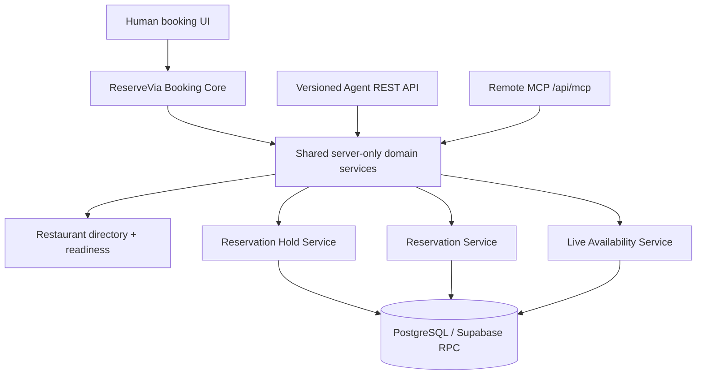

# AI-native reservation architecture

ReserveVia now treats its booking core as provider infrastructure. The existing UUID in `restaurants.id` is the immutable machine/provider identity. `restaurants.slug` remains a mutable human routing identity. Restaurant names and domains are never used as stable identifiers.

## Current canonical paths

| Capability | Canonical implementation |
| --- | --- |
| Restaurant identity | `public.restaurants.id` (UUID) |
| Publication | `status = published`, `platform_status = active`, active workspace and plan entitlement in `lib/services/public/restaurant-service.ts` |
| Public profile | `fetchPublicRestaurantProfileBySlug` and `toPublicRestaurantProfile` |
| Availability rules | `validateReservationAvailability` plus restaurant/area settings |
| Human create | `app/actions/reservation-actions.ts#createReservation` |
| Human update/cancel | reservation actions and secure business management token flow |
| Capacity | `reservation_areas.max_concurrent_reservations` where configured |
| Quota | existing reservation insert trigger and workspace usage period quota |
| Human retry idempotency | `reservations.public_submission_id` |
| Agent idempotency | `reservation_operation_idempotency` |
| Rate limiting | `consume_public_reservation_rate_limit` reused with AI policy namespaces |
| Tenant authorization | `lib/authorization.ts`, hostname resolver, workspace entitlements |
| Hosted domains | `{slug}.reservevia.com` via `lib/domains/public-resolver.ts` |
| Custom domains | verified `restaurant_domains` via the same resolver |
| Public directory | `fetchPublicRestaurantDirectory` |

## Proposed and implemented boundary

Adapters return explicit DTOs and stable machine errors. They never return Supabase rows or duplicate tenant, quota, opening-hours, or party-size rules.

## Data boundaries

Public: published restaurant name, safe profile fields, structured address, coordinates, phone, official website, canonical URL, timezone, booking capability, required guest field names, and live availability.

Private: guest name, phone, email, notes, reservation management tokens, API credentials, workspace data, claim data, internal notes, and operational errors. These are excluded from JSON-LD, sitemaps, business feeds, search results, docs, and MCP metadata.

## REST and MCP

Public discovery and availability are anonymous but separately rate limited. Trusted clients use hashed provider-neutral credentials and scopes. Holds, reservations, modifications, and cancellations use idempotency keys. Reservation management additionally requires an opaque scoped token; a UUID alone never authorizes a private read or mutation.

MCP uses the current stateless Streamable HTTP transport. It does not depend on in-memory sessions. `hold_id`, reservation IDs, idempotency keys, and management tokens make progress explicit and retry-safe. `restaurant_reservation` opens the OpenAI-compatible widget flow; direct mutation tools are configuration-gated.

## OpenAI and discovery

The business feed exports only strict feed-eligible published restaurants. It uses stable IDs, deterministic ordering, bounded pagination, opaque HMAC tokens, revision-based checksums, and safe caching. Restaurant pages are server-rendered with canonical metadata and Restaurant JSON-LD, including `ReserveAction`. `OAI-SearchBot` is explicitly allowed; model-training crawler policy is separate and defaults to disallow.

## Security model

Restaurant-authored text is untrusted data. It is never inserted into instructions, interpreted as executable HTML, followed to alter tool behavior, or fetched as an SSRF target. URLs are protocol-validated. API errors are safe and carry retry guidance. Request IDs and operational events can be logged without guest PII, credentials, tokens, or notes.

## Source-of-truth rules

1. The existing reservation engine remains authoritative for human booking behavior.
2. The shared AI availability and reservation services reuse the same restaurant/area validation and database quota/capacity constraints.
3. REST and MCP are transport adapters; no handler owns business rules.
4. Public pages and feeds describe restaurant state but never publish static availability.
5. Public docs are sourced from `docs/public/`; HTML, Markdown, `llms.txt`, and `llms-full.txt` are renderers of that source.
