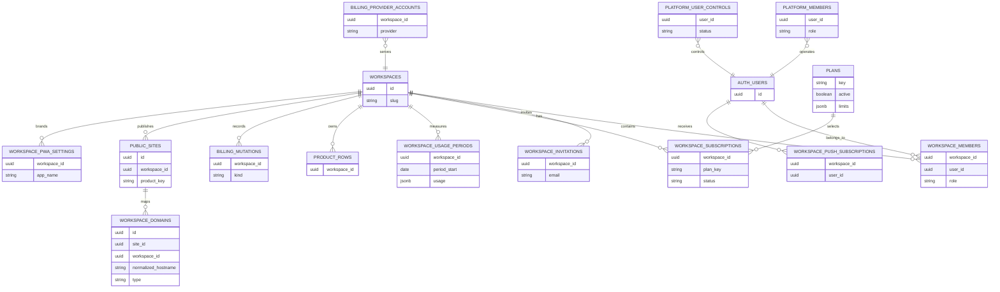

# Database guide

SaaS Core uses Supabase Auth and Postgres as the tenancy boundary. The
application shell can make a route look private, but only server-side
authorization plus database privileges and RLS make a row private.

## Model



`PRODUCT_ROWS` is a conceptual placeholder for a product table; it is not a
Core table and must never be added to a Core migration.

## Core table inventory

The baseline Core migration creates these public tables. They are all RLS
enabled; later additive migrations add durable billing persistence and tighten
membership/entitlement boundaries.

| Area | Tables | Client posture |
| --- | --- | --- |
| Tenancy | `workspaces`, `workspace_members`, `workspace_invitations` | Authenticated reads are scoped; membership mutations use Core RPC boundaries. |
| Plans and entitlement | `plans`, `workspace_subscriptions`, `workspace_usage_periods`, `subscription_overrides` | Authenticated plan/subscription/usage reads are limited; writes are server-controlled. |
| Public surface and workspace capability | `public_sites`, `workspace_domains`, `workspace_pwa_settings`, `workspace_push_subscriptions` | Public sites and domains are workspace-owned; provider operations stay server-side. |
| Billing persistence | `billing_provider_prices`, `billing_webhook_events`, `billing_checkout_sessions`, `billing_mutations`, `billing_cancellation_feedback`, `billing_provider_accounts`, `billing_mutation_transitions`, `billing_transition_consumptions` | Revoke public/anon/authenticated table access; use server RPCs and service-role code. |
| Platform | `platform_members`, `platform_user_controls`, `platform_audit_logs`, `platform_settings` | Server-only operator boundary, separate from Workspace roles. |
| Email delivery | `email_delivery_events`, `email_delivery_attempts`, `email_provider_webhook_events`, `email_outbox_runs` | Server-only outbox, retry and webhook state. |

The private schema contains `private.core_schema_metadata` and
`private.core_settings`. These store the schema coordinate and server-owned
settings such as the configured default plan. Public client roles are revoked
from the private schema. Storage uses the `workspace-assets` bucket with
workspace-aware object policies.

## Domain foundation

The additive domain migration keeps `workspace_domains` as the compatibility
table for the existing provider reconciliation workflow and adds
`public_sites` as the reusable public-surface boundary:

```text
Workspace
  ↓
PublicSite { workspace_id, product_key }
  ↓
Domain { site_id, normalized_hostname, type, status, is_primary }
```

`normalized_hostname` has a global unique index, `(site_id, workspace_id)` is
enforced by a composite foreign key, and partial unique indexes allow at most
one platform domain and one primary domain per public site. Existing domain
rows are attached to a neutral `legacy` public site without guessing a
product. The Core service creates explicit product-key sites for new flows.

`public_sites` and `workspace_domains` are RLS-enabled for owner/admin
management. The platform claim and host-resolution RPCs are service-role-only;
server code must authorize the requested Workspace before invoking the claim
operation. Public resolution uses only the exact active mapping and never a
Workspace slug fallback.

## Product table recipe

Put an adapted version of this in a new, timestamped Product migration directly
under `supabase/migrations/`. Apply it once with a product-specific table and
policy name; the standard Supabase CLI will execute it and Core will preserve
it during updates. Existing consumers may retain legacy files under
`supabase/migrations/product/`; Core preserves that namespace but new work
should use the flat Supabase-native layout. Flat means a direct-child SQL file
only; arbitrary nested SQL outside the legacy namespace is noncanonical,
preserved with a warning, and not assumed to execute through the normal
Supabase migration flow.

```sql
create table public.projects (
  id uuid primary key default gen_random_uuid(),
  workspace_id uuid not null references public.workspaces(id) on delete cascade,
  created_by uuid not null default auth.uid() references auth.users(id),
  name text not null check (length(trim(name)) between 1 and 160),
  created_at timestamptz not null default timezone('utc', now())
);

create index projects_workspace_id_idx on public.projects (workspace_id);

alter table public.projects enable row level security;
grant select, insert on table public.projects to authenticated;

create policy projects_read on public.projects
  for select to authenticated
  using ((select public.is_workspace_member(workspace_id)));

create policy projects_insert on public.projects
  for insert to authenticated
  with check (
    (select public.is_workspace_member(workspace_id))
    and created_by = (select auth.uid())
  );
```

For a product that restricts creation to owners/admins, replace the membership
helper with `public.has_workspace_role(workspace_id, array['owner', 'admin'])`.
For `UPDATE`, grant the operation and create both a `USING` and a `WITH CHECK`
condition; the role also needs a compatible `SELECT` policy. Add a `DELETE`
policy only when the product has a deliberate deletion rule. Do not use a
broad `using (true)` policy, trust a hidden UI button, or send a service-role
key to browser code.

## RLS and privilege principles

- Enable RLS on every product table exposed through the `public` schema.
- Name the role explicitly: use `to authenticated`, not an implicit all-role
  policy.
- Scope with `(select auth.uid())` or a Core membership/role helper so the
  authorization predicate is clear and indexable.
- Index every product foreign key used by a policy, especially
  `workspace_id` and `(workspace_id, created_by)` where appropriate.
- Keep server-only provider, billing, platform and private-schema operations
  behind server code and restricted RPCs.
- Use foreign keys, `not null`, `check`, unique and exclusion constraints to
  make invalid tenancy states hard to store.
- Keep transactions short. Core entitlement mutation functions use a
  transaction-scoped advisory lock for the workspace and re-check the current
  plan state before writing.

## Migration lifecycle

Core migration sources are the exact direct files under
`supabase/migrations/*.sql` shipped by the application template and CLI,
including `20260916100000_saas_core_domain_foundation_v1.sql`.
Product migrations use the same flat directory but are the direct `.sql` paths
not claimed by that Core source/manifest set. Existing nested
`supabase/migrations/product/**` files remain Product-owned for compatibility;
other nested `.sql` paths are noncanonical and are not treated as native
Product migrations. Non-SQL files in migration directories are not migrations.
The CLI copies, hashes and compares source; it does not run SQL, reset a
database or overwrite a Product migration. Ownership and chronological
Supabase execution are separate concerns: Core and Product files may be
interleaved by timestamp.

```bash
pnpm db:start
pnpm db:reset
pnpm db:types
pnpm db:test:schema
pnpm db:test:clean
```

After a product migration, inspect `types/supabase.ts`, run a focused RLS
test with authenticated and unauthenticated clients, and verify the resulting
schema in the same environment before promotion. A `saas-core doctor` database
warning means credentials were unavailable; it is not evidence of an applied
migration.
