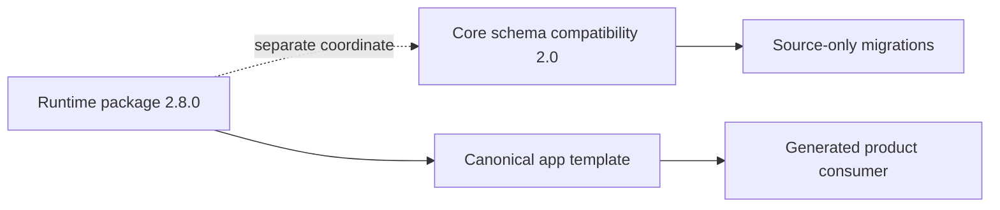
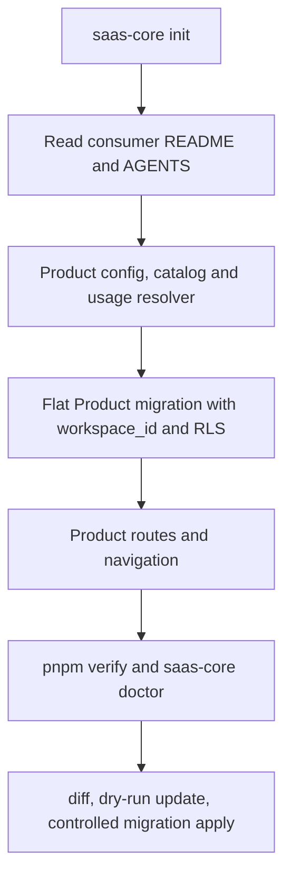

# Start here

SaaS Core separates a reusable Workspace platform from the product that gives
that Workspace a reason to exist. Use the path that matches the work in front
of you.

## Coordinates and release truth

The published runtime and package coordinate is `2.8.0`, anchored by
`saas-core-v2.8.0`. The Core schema compatibility coordinate is `2.0`.
See the [2.8.0 release notes](./RELEASE-2.8.0.md) for backend verification.



## I am working on SaaS Core

Read in this order:

1. [`AGENTS.md`](../AGENTS.md)
2. [`ARCHITECTURE.md`](./ARCHITECTURE.md)
3. [`OWNERSHIP.md`](./OWNERSHIP.md)
4. [`DATABASE.md`](./DATABASE.md) and [`SECURITY.md`](./SECURITY.md)
5. [`UPGRADING.md`](./UPGRADING.md) for consumer lifecycle changes

The fast local loop is:

```bash
pnpm install --frozen-lockfile
pnpm lint
pnpm typecheck
pnpm test:run
pnpm run core:source-parity
pnpm run core:consumer-contract
```

With the isolated local Supabase project running, add:

```bash
pnpm db:start
pnpm db:reset
pnpm db:types
pnpm db:test:schema
pnpm db:test:clean
```

`pnpm verify` is the no-credentials source contract: repository hygiene and
its failure-path test, lint, typecheck, unit tests, root/template parity and a
fresh CLI consumer contract. The broader `pnpm release:check` additionally
exercises local database, packaging and release proofs.

## What belongs in Git

Keep canonical source, deterministic product fixtures, migrations, public
assets, package manifests, docs and CI workflows. Generated but intentionally
versioned contract files are `next-env.d.ts` and the reviewed
`types/supabase.ts` snapshots. Local dependency installs, build output,
coverage, Playwright reports/runtime state, Supabase `.temp`/`.branches`,
package tarballs, logs, credentials and temporary consumer proof directories
must stay ignored.

The fresh consumer receives a product-specific `.gitignore` from the canonical
`packages/app/template/consumer.gitignore` source. It is created when missing
and is not overwritten during Core updates, so product repositories can extend
their local policy safely. Run `pnpm repo:hygiene` from Core to inspect the
tracked set and `pnpm verify` before handing off changes.

## I am building a product on SaaS Core

Use Node.js 24 and pnpm 11.21 or later in the 11.x series. To start from the
published release:

```bash
pnpm dlx @sapienx/saas-core-cli@2.8.0 init "My Product" ./my-product
cd my-product
pnpm install
cp .env.example .env.local
```

For a clean database, follow [Neon setup](./NEON.md) before running `pnpm dev`.
For an existing Supabase consumer, use its current database configuration.

The generated consumer includes its own `README.md`, `AGENTS.md`,
`.env.example`, lint/test configs, local database helpers, catalog sync helper
and Core manifest. Its Supabase ports are isolated in the 555xx range; the
root Core checkout uses 556xx ports.

The product journey is:



The product owns its domain data model, product routes, catalog copy, product
styles, product migrations and generated Supabase types. Core owns canonical
public hostname mappings and products consume its Domain/PublicSite resolver
contract. New Product
migrations live directly under `supabase/migrations/`; Core claims only the
exact migration paths shipped by its source/template. Existing
`supabase/migrations/product/` files remain preserved as a legacy compatibility
namespace. Core owns the Workspace boundary, authorization primitives and
shared management surfaces.
See [`PRODUCT-INTEGRATION.md`](./PRODUCT-INTEGRATION.md) for the longer
integration contract.

Native flat means a direct-child SQL file only:
`supabase/migrations/<filename>.sql`. Arbitrary nested SQL such as
`supabase/migrations/foo/bar.sql` is preserved and warned about as
noncanonical; it is not assumed to execute through the normal Supabase flow.
Non-SQL files under the migration directory are not migrations.

## First database change

Use the table recipe in [`DATABASE.md`](./DATABASE.md#product-table-recipe).
The important invariants are:

- every tenant-owned row has `workspace_id` referencing `public.workspaces(id)`;
- the product adds an index for that foreign key;
- RLS is enabled and policies target `authenticated` explicitly;
- server authorization and database RLS both protect the row;
- new product migrations live directly under `supabase/migrations/`; existing
  nested `supabase/migrations/product/` files are preserved for compatibility;
  other nested SQL is noncanonical and may not execute normally.

The CLI copies migration source but never runs SQL. Apply and verify database
changes through the consumer's controlled Supabase workflow.

## Find the next guide

| Need | Guide |
| --- | --- |
| Ownership, update safety, path rules | [`OWNERSHIP.md`](./OWNERSHIP.md) |
| Tables, RLS, privileges, migration workflow | [`DATABASE.md`](./DATABASE.md) |
| Product routes, config, catalog and usage | [`PRODUCT-INTEGRATION.md`](./PRODUCT-INTEGRATION.md) |
| Plan and limit lifecycle | [`PLAN-CATALOG.md`](./PLAN-CATALOG.md) |
| Billing architecture and certification | [`BILLING-ARCHITECTURE.md`](./BILLING-ARCHITECTURE.md), [`BILLING-CERTIFICATION.md`](./BILLING-CERTIFICATION.md) |
| Agent tools and server boundary | [`AGENT-SURFACE.md`](./AGENT-SURFACE.md) |
| Security review | [`SECURITY.md`](./SECURITY.md) |
| UI conventions | [`UI-SYSTEM.md`](./UI-SYSTEM.md) |
| Consumer upgrade | [`UPGRADING.md`](./UPGRADING.md) |
