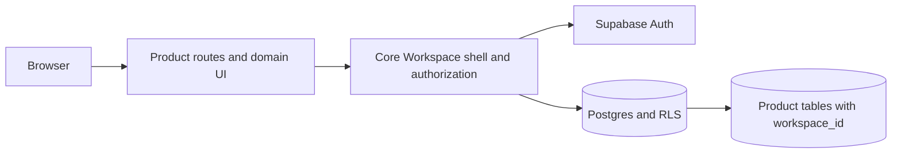

# __PRODUCT_NAME__

A product workspace built on the SaaS Core foundation. Core owns identity,
Workspace tenancy, membership and authorization primitives, entitlements,
billing persistence, domains, PWA, email, push, Platform administration and
the update contract. This repository owns the product experience that starts
at the Workspace boundary.

## Start here

Run this once from the product root:

```bash
pnpm install
cp .env.example .env.local
# For this Supabase local setup, set NEXT_PUBLIC_SAAS_CORE_BACKEND=supabase in .env.local.
pnpm db:start
pnpm exec supabase status --workdir . -o env
# Put the local URL, anon key, service-role key and JWT secret in .env.local.
pnpm db:reset
pnpm db:types
pnpm dev
```

The local Supabase project is isolated on the 555xx ports. Mailpit is available
through the app at `/api/dev/mailpit` or directly at
`http://localhost:55524`. Keep `SUPABASE_SERVICE_ROLE_KEY` server-only; only
the `NEXT_PUBLIC_*` values belong in browser code.

The generated `.gitignore` protects this product repository from dependency
installs, Next/Turbo/build output, browser evidence, local Supabase state,
package tarballs, logs, credentials and editor state. Extend it for product
tools when needed; Core updates do not overwrite it.

## The boundary



The product layer normally lives under `app/(product)/app`, `src/product/`,
`components/product/`, and new timestamped migrations under
`supabase/migrations/`. Configure the workspace home and navigation in
`lib/product-config.ts`; do not fork Core navigation or tenancy logic.

Core also owns the canonical public-domain boundary. Public host resolution is
`hostname → Domain → PublicSite → Workspace → productKey`; use the typed Core
domain service and `resolveHost()`/`resolvePublicWorkspaceRequest()` from
server code. Do not create a product hostname table or query
`workspace_domains` directly. `productKey` selects the renderer; Workspace
remains the ownership boundary.

## Add product value

1. Define product tables in a product migration. Every tenant-owned row needs a
   `workspace_id` foreign key and its own RLS policies.
2. Add product routes below `app/(product)/app` and product UI under
   `components/product/`.
3. Register the home path and navigation in `lib/product-config.ts`.
4. Add product usage resolvers to the server-only
   `src/product/usage.ts`, then declare matching limits or usage metrics in
   `product.catalog.json`.
5. Run the catalog contract and synchronize plan presentation only after the
   database is ready:

```bash
pnpm run billing:sync-catalog -- --dry-run
pnpm run billing:sync-catalog
```

Catalog sync uses server-only Supabase credentials. It writes Core plan
configuration while leaving provider price IDs and provider mapping ownership
to the product's billing integration.

For the first product table, adapt the safe recipe in
[docs/DATABASE.md](https://github.com/SapienXai/saas-core/blob/main/docs/DATABASE.md#product-table-recipe).
The recipe is intentionally not executed by this CLI.

## Database lifecycle

Core migrations use source-only delivery under `supabase/migrations/`. Core
owns only the exact migration paths shipped by its template/manifest. Product
migrations use the same direct-child flat directory at paths not claimed by
Core and are preserved byte-for-byte by Core updates. Existing files under the
legacy `supabase/migrations/product/` namespace are also preserved, but new
files should be flat so the standard Supabase CLI executes them normally.
Arbitrary nested SQL outside that legacy namespace is noncanonical: Core
preserves it and warns that it may not execute through the normal Supabase
flow. Non-SQL files are not migrations. The CLI never executes SQL, resets a
database, or overwrites a product migration.

Use the consumer's controlled workflow:

```bash
pnpm db:reset       # applies the checked-in source locally
pnpm db:types       # regenerate product-owned types/supabase.ts
pnpm run db:types   # equivalent explicit form
```

After a schema change, review the generated
`types/supabase.ts` diff and verify the RLS behavior with a focused database
test before applying the same source to a shared environment.

## Verify and update

```bash
pnpm verify
pnpm saas-core:doctor
pnpm saas-core:diff
pnpm saas-core:update:dry-run
pnpm saas-core:update
```

`verify` runs lint, typecheck, tests and a production build. The CLI doctor
also checks the Core-managed migration and source contract; a database warning
means credentials were not available, not that SQL was silently applied.

Core updates are ownership-aware. Review `diff --json`, resolve any modified
Core-managed conflict explicitly, apply migrations through your normal database
process, regenerate types, reinstall dependencies, and rerun verification.
README, AGENTS.md, .env.example, product config/catalog, product routes/styles,
product migrations and generated database types are product-owned and are not
overwritten by `update`.

## Ownership summary

- Core-managed: files shipped by the canonical template, including auth,
  Workspace, membership, authorization, billing, Platform, domain/PWA/email/
  push infrastructure, direct Core migrations and helper scripts.
- Product-owned: this README, `AGENTS.md`, `.env.example`, product routes,
  catalog, styles, flat product migrations (plus legacy nested migrations),
  product usage and generated database types. Arbitrary nested SQL is
  preserved as noncanonical rather than treated as a native migration. Product
  migration ownership is based on Core source/manifest identity, not filename
  words or SQL contents.
- Mixed: `package.json` keeps the product's name, scripts and dependencies;
  the CLI updates only the four Core package coordinates.

Read the generated [AGENTS.md](./AGENTS.md) before changing the repository.
The authoritative ownership list is maintained in the upstream
[OWNERSHIP.md](https://github.com/SapienXai/saas-core/blob/main/docs/OWNERSHIP.md).
